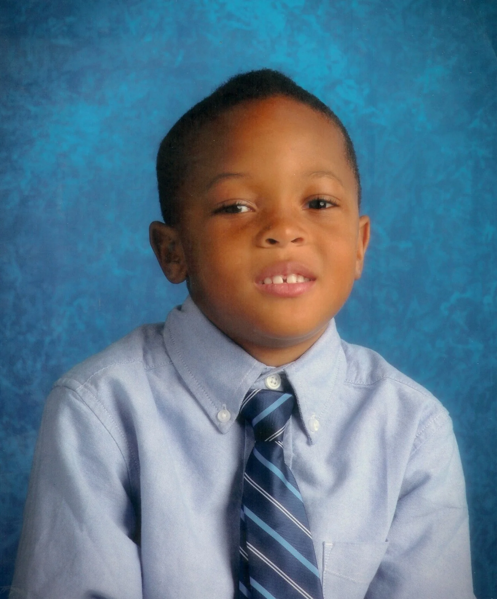

Brian {Exacting & Cool} has a highly attractive personality, yet he is not overly social. This creates a problem for him, although he has a great need to be in the limelight, he has a greater need to spend time alone.

Aaron {Witty & Charismatic} has ultra quick impulses and a fertile imagination, sometimes overly so. He's at the age where he is striving for independence and freedom of thought.

Davina, AKA" Dorian " {Truthful & Discerning} has a demanding personality and no one can match her attention to detail or her power of concentration on the task at hand. She is extremely discriminating, possibly to the point of being judgmental.
