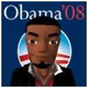

The day after the Municipal Elections I just so happened to need a fresh cut so I made my way to the Barbershop. I anticipated lively interchange on the typical shop talk, on Twitter I give it the hash-tag #barbershopphilosphy. This has reached the top trending spot several times. Politics, Religion, Sports and Sex (not necessarily in that order)

**On Religion**

The topic centered on churches in the community who are here to serve themselves and those who are here to serve the lord. The conversation also focused on serving the homeless vs creating opportunity for the homeless. ☚ But the title of this post is "I voted for the black guy" … let's move on.

**On Sex**

There was a guy selling Viagra pills for $25 bucks a pop ☚ No pun Intended.

**On Sports**

Yankees in seven. Kobe vs Lebron. The Bobcats & The Panthers. ☚This one's for North Carolina! ♬ C'mon and raise up ♬ Take your shirt off, twist it 'round yo head ♬ Spin it like a helicopter ♬ North Carolina go on and raise up!

**On Politics**

Okay, here is where the conversation got heated. It started with a simple question of "Did you vote?" Who knew three words could spark such a heated debate. For those of you not knowing the local mayoral race saw an African-American, Negro, Black Man (Anthony Foxx) run against a Caucasian, White Man (John Lassiter) The Governor's seat was open due to the decision by Mayor Pat McCrory, a Republican, not to seek re-election. Anthony Foxx, a member of the City Council, won the election by a slim margin, becoming the first Democrat elected to lead the city since Harvey Gantt was re-elected in 1985.

**Issues with the Black Community**:

The debate was not really about race but it was? Huh?? "I voted for Foxx because he was student council President at West Meck." "I voted because he is a democrat." "I would have voted for him because he's black." These statement were not polled by me nor or these any of my answers. I was just an innocent observer. The one Black Republican questioned them … What was Anthony's platform? What are the issues that concern you?

**Issues with the White Community:**

The debate was not really about race but it was? Huh?? "Ok-now the Dems ☚ Translation(Blacks)have complete control…No one to blame but themselves from this point on." "Charlotte just screwed up and at a time when the city is going down the tubes."

I can't answer for anyone else and what is important for me may not be as important for anyone else. (But it should cause' I'm right 99.9% of the time) I voted for the black guy not because of race but because of the issues that were important to me. I have no doubt that John Lassiter was capable of running this city, the two were dead even on issues they just had different views on how to achieve them.
