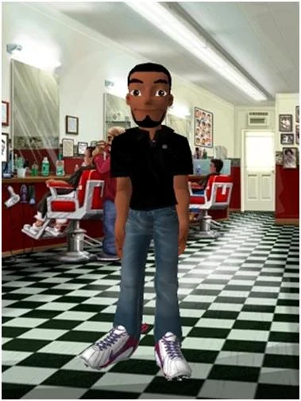
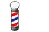
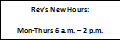

Another morning in the Barber Shop.

For as long as I can remember the neighborhood barber shop has been a community gathering place. People who visit for a haircut also have the benefit of the in-between talks during the hair cutting sessions. What I like to call "Barbershop Philosophy". The rational inquiry into the principles and truths of being, nature, knowledge, conduct, etc. of course from the black perspective.

**THE BARBERS**

*The Owner / Barber*

Wouldn't know it to look at him but this guy is filthy! As in filthy rich. Nice house owns a small real estate firm, summer house & used auto-dealership in Jamaica. They say you are a product of your environment … well he has a lil' bit of each of the barbers, characters and customers rolled up in his personality. The owner is very nice with the clippers, to him haircutting is an art and has to be mastered like any other profession. Once you rise up from the chair you feel as if your personality has been polished. You stand a lil' taller and speak a lil' louder.

*The Reverend*

Never has any customers but prominently post his shop hours. He also runs auto-parts for Napa. {Note to Rev this sign is 10 years old}  

*The Homey*

"Ayo! What's up son?" Better city in America? According to Homey … not fucking likely. That's right Homey is from NYC the transplant that cut hair out of his home for 10 years came down south to school these country ninjas in the art of barbering. Took him 3 years to get licensed but Ayo son! … He did it his way.

*The First Chair*

Fresh out of Clown Barber College, he ends up with the walk-ins and the small kids. He's nice with the clippers, although I did see him patch a dude up once. {Keep practicing on those small kids}

**THE CHARACTERS**

*The Coach*

No one knows what he actually coaches, he has on the gear, looks the part and he just stops by in between practices (which happen to be year round). You can't leave without hearing one of his motivational quotes. "Big B, listen my man before you go … If everything seems to be going well, you obviously do not know what the hell is going on."

*The Retiree*

Yep, meet Mr. Me Too. He will not be outdone. You've run with the bulls in Spain? Well he's run butt naked with the lions in the Serengeti. Forgot a little piece of the city's history? It's okay; he remembers the city when it was just a dirt road.

*The Hustle Man*

You never see him actually in the chair, but his hair is always cut. Not your average "hustler" he's not about the illegal acts, but about anything that will make him money. He'll shampoo your carpet if you rent the machine, pick him up and drop him off at the barber shop when he's through. His favorite line … "I know a guy" and he will invent a word for anything\*

The Player: "What's up fam!? Man, I just lost a hubcap" {Did this ninja say hubcap? Where tha' 22's at playboy?}

Hustle Man: "I know a guy that can get you 4 brand new capo's\* for the cost of one." {What the eff' is a capo?}

*The Player*

This guy. Always looking in the mirror at himself before, after & during his cut. The thought bubble above his head reads ..."Man I'm so attractive" He actually believes any woman would be blown away if they sat down and had a chat and got to know him.

**THE CUSTOMERS**

*The Soccer Dad*

So busy with family stuff, I mean if he could just clone himself life would be grand. "I gotta get outta here ya'll lil' Nathaniel William Edward Burghardt Du Bois III has T-Ball practice and I have choir practice at the church.

*The Gay Guy*

You never know he's in the shop cause his head is buried in his iPhone. I always admire what he has on, great style ~ {No Homo} & Ohhh Mmm Gee the whip! CLS5500! When he's done & drives that thang' \*Pause\* out of the parking lot all heads \*Supa Pause\* turn and this normally starts the discussion on cars.

*The Educated Brotha' From the Bank*

Comes in on his lunch break with the same bullisht every time. "How many I got in front of me?" Like his life is much more important than ours. Hustle Man likes to eff with him.

Hustle Man: "Ayo Educated Brotha' From the bank? You work for Bank of America right? What branch do you work at?"

Educated Brotha' From the Bank: "I've told you that I work in Commercial Mortgage Backed Securities not at any of the retail branches."

Hustle Man: "My bad, let me get a loan then?" {Shop erupts in laughter}

*The Female*

Comes in to get her eyebrows arched and neckline shaped. I think she's crushing on homey.

**THE DISCUSSION TOPICS**

*Sports*

Conversations about home town heroes like Chris Leak and why none of the NFL teams picked him up. The Bobcats, The Panthers, Independence High football dominance. Everyone in the shop is a Sports Analyst giving their take. The sports conversation is generally tame but it is without fail. "Well you know he dating that white girl" … which takes us into the next discussion topic

*Women / Sex / Marriage / Relationships*

This topic brings out the comedians.

On Women

Physical Properties: Found in various states from virgin metal to common ore.

Chemical Properties: Most powerful money reducing agent known to man.

Common Uses: Very effective cleaning agent.

Hazards: Illegal to possess more than one, although several can be maintained at different locations as long as specimens do not come into direct contact with each other.

*Religion*

No arguments or heated discussions here, faith is respected in the shop, where the conversation lives is the "service" of the church and the role it plays in the community concerning; drugs, homelessness, outreach and youth services. Always surprised at how well folk know the Bible or Qur'an. The interpretation is where it gets lost. The most revisited topic tithing; if you should at all, what the bible says, ten percent before or after taxes? {Never ending debate. I've been going there for 10 years & this never gets old to us.}

*Politics*

Currently "we on that" Health Care debate. Always on topic … What's missing from the debate, which has the better philosophy and is Michelle & Barack breaking in every room in the White House.

*Cars*

The Charlotte International Auto Show was last week and "we on that" [Porsche Panamera](http://www.porsche.com/usa/models/panamera/)

This list is not even close to half of the characters, personalities and topics discussed in the Barbershop. I didn't mention the fish fry lady or the bootleg music and dvd hustlers. They are out there in yo' shop!

Who are some of the characters at your shop & what they be philosophizing bout'?

Check out this video directed by Nelson George [A Barber's Tale](http://www.youtube.com/user/NANnetwork)
