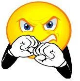

I get myself into trouble sometimes because I use humor, sarcasm and witty snap backs usually to express some critical comment. My bio is true ...

"Sometimes nit-picky & critical, “secretly” feeling he handles matters better than others"

How ironic.

Do As I Say Not As I Do

Know When To Be Serious And When To Let Up

Don’t Let Teasing Get Out Of Hand

Beware Of Third-Party Rivalries

Act With Consideration To All
