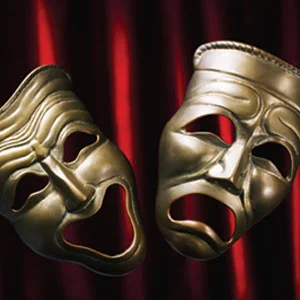

Jaded cynical attitudes can be deadening.

I ran into an acquaintance from high-school a few days back. Notice I wrote “acquaintance” … notice I wrote “High-School”.

I’ve been away from high-school for a minute, to give you an idea how long that’s been, my transcript reads “Gender: Male Race: Negro”

{Stepping Away for a Minute}

In school I was reserved, not shy or an introvert but more selective about whom I gave the business to socialize with. I was an average athlete good at most but never excelled. My theory on the self-reliance and independence is associated with growing up in a house that was one of two houses on a block where the only other structure was a church. I believe you are a product of your environment and I am just like the house I grew up in self-sustained and independent.

{Now I’m Back}

Of Mr. Play Actor and others who seem to hold onto their “self-proclaimed” glory days and awareness that all the world is a stage, fully embracing the various opportunities for role-playing. People with low self-esteem are caught in powerful emotional beliefs about themselves. No I didn’t make the varsity basketball team; No I’m not still in a marching band; no I’m not still dating Halle Berry. Man that was years ago. However, Mr.TramueL™ see’s through your mask. These things are all said in an effort to BIG you up. The conversation never progresses past sh\*t that we used to do and I keep getting pulled back to the future … Me: “Oh, that’s great man, the little dance group didn’t work out for you? That’s okay cause’ you’re the night manager at McDonald's now huh? That’s good, real good.” People with low self-esteem often look desperately for evidence that they're good. You don’t have to put others down to bring yourself up.

“Welcome to McDonalds may I take your order please?” Yes, I would like for you to have the rewards of self-knowledge.

Do As I Say Not As I Do

☛ Beware of competition and jealousies.

☛ Don’t hold on to your pain.

☛ Drop the mask.
