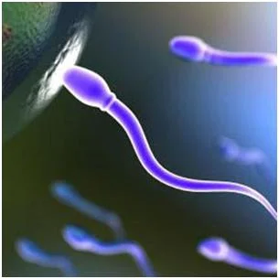

I had a visit with my old roommate; she was holding some mail for me at her place. Yes, I said she. I know you are wondering "Did Mr.TramueL smash?" well kids the answer is no, now stay focused & keep your minds out of the gutter. Although once or twice she did show up at my door butt naked talking bout' how she was so alone. We made small talk about the weather, the bank (we use to work together), my kids, the holidays, her family and then her "sperm donor." In a rather nonchalant way she proceeds to tell me that her biological father had passed. Given what I knew about their relationship the smirk on her face confused me, well maybe not. I mean we lived together for a little over a year so I thought I had her diagnosed as bipolar figured out, so her whole demeanor perplexed me. Being the intelligently hedonistic person that I am, I decided to probe a little further and ask how she really felt. She found out on Christmas day, an Aunt called her mom to let the family know. We got through my investigation without coming to blows, which is surprising, cause' at one point I was standing over her with the spotlight shining directly at her soul wanting her to break down and cry for this man who cared so little about her life. I went hard! \*Pause. End Scene\*

I sit down on the couch, she didn't break. I thought she was using the smirk as some type of inner defense mechanism to block her true pain, but I don't believe she felt any kinda way. Why was I so obsessed? ***Unlike*** her my "sperm donor" {Those are her choice words} I like to refer to him as "the punk ass mofo who impregnated my mother and didn't give a flying eff about anyone but himself selfish ass bastard" but that's too long so we will use "sperm donor" … \*Clears Throat\* ***Unlike*** her if I passed my sperm donor on the street I wouldn't know it was him, ***unlike*** her I don't know if I have any brothers or sisters fathered by him, ***unlike*** her I never knew where he lived. ***Unlike*** her I never had an opportunity to converse {Is conversate a word?} with him.

Women whom I've been involved with seem to think that this missing piece of my life is somehow hindering or holding me back from really committing to someone {That's a whole notha' post} and I often wonder if I use some type of inner defense mechanism to make me believe that I don't care. *L**ike*** her I really don't care, if someone told me he passed I wouldn't feel anything. My mother married when I was five, I have a wonderful step-father that has been and is still a positive influence in my life. So we stole we didn't get stole on.

I could go on but …

**Do As I Say Not As I Do**

✍ Be more realistic about yourself.

✍ Beware of negative expectations.

✍ Slowly build a solid base of self-confidence.

✍ Accept your fate.
