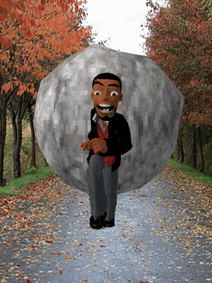

Push Me, Pull You

Beware of running away from problems.

After a textersation {I just coined this phrase … conversation through texting} with a good friend I’ve realized that I believe I know what other people want, but don’t really know what I need.  My unspoken admiration for the folk that keep me grounded, sane & motivated is the reason for this post. They are a part of my life; some new, some old, some share my blood, some don’t, all-in-all  they all are a part of my family, immediate and extended.

I shine when I serve others in some way and  what I get back in return is far more beneficial to me than any 1ne of them can imagine. They bring me closer to capital {G}od’izzle, by desiring a closer relationship with HIM. They make me want to know more, thus inspiring me to read more & research more. They have taught me to be more honest. {Ya’ll know T!his is a struggle cause I enjoy story-telling and sometimes enjoy bending the truth} They inspire me to be a better father, brother, son & man. Last but not least, they’ve taught me to straighten out confusion or nothing will get done. I have some huge  stones chasing me that I’ve now begun to face and stop running from.

I take in so much from my environment; T!his is one of the reasons why I tend to be indecisive, swinging between irrational and rational thoughts and feelings. It's pretty much something that takes place "upstairs" in my mind, although others are sure to see the struggle from time to time.  I also have a tendency to misrepresent myself with what I say from time to time, but Mr.TramueL is a charming, if a little kooky, friend, father, brother, son & man.

Continue to *Push Me* & I’ll continue to *Pull You*.

In Gratitude,
