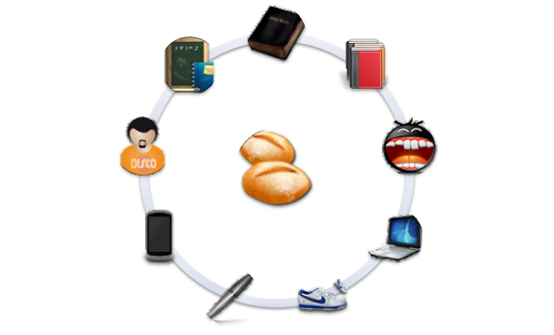

Not no parkay, not no margarine, strictly butta …

I’ve been on a journey and my mantra for Two Thousand Ten is “ Striving to create balance & harmony; Spiritually, Mentally, Emotionally and Physically”

The moral and intellectual crisis of out time has not yet spared the true science of …  I’m just playing. I’ve been reading, studying, analyzing, meditating & re-directing a lot of my energies and I’m in a place I haven’t been in a long time.

This post is simply affirmation to the Universe of (1)ne of life’s lessons learned. ***“Unattachment”** - The release of need or expectation associated with a specific outcome.*

We see & believe how a specific event or situation will work out and we become “attached” imagining it happening just as we envision. We try to duck & dive trying to force the circumstances to our advantage, but a four letter word beginning with L and ending in E (No, not that one) … *Life* has it’s own schedule.  Unattachment  doesn't mean that you’re not keeping it one hunid’, it means that you are managing your  expectations. I know, I hear you saying “Give us an example Mr.TramueL!” Okay, okay … I want to be a rapper O\_0 and it is normal for me to pursue those goals, the key to piece of mind is to hold on lightly to the image of me on a sold out stage ( ‘cause it’s tricky to rock a rhyme that’s right on time ) Unattachment happens when I’m not tied to the idea of being on a sold out stage, the reality is probably more like me on a karaoke stage. Things didn’t work out as planned but I’m more than able to let it go. {Lesson}

Drops Mic. Walks off stage snapping fingers spit'n mad fire son! … ♬  Well yo, ♫I funk like dat ,I'm fat like dat, I'm in like dat, ♪ I jazz like dat, I freak like dat, I zoom like dat,♫ I’m out ... I’m out.

Mr. “It’s Like Butta Babeey” TramueL
