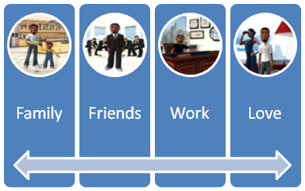

RE-POST! I posted this on Posterous a while ago, wanted to give the people something to step to. I'm coming back soon ~

My determination to always be at my best is typically magnified in most of my relationships granting me little rest. However when that phone call, e-mail or text message comes with those famous words "Hey, What you doing. Guess What?"

… I get all emotional (I'mma keep it short. I don't want another another feminine moment. I can't stand the smell of that night blooming jasmine.)

They picked me! They could have chosen anyone but they chose me! It feels good when I am able to impart my impractical wisdumb upon the earth.

[**Do as I say not as I do**](http://extroversionbelied.posterous.com/?sort=&search=needing+to+be+needed "Do As I Say Not As I Do")Be aware of your effect on others.

Do not exhaust yourself in pursuit of the latest trend.

Seek traditional values.

\*Remember a house can not be united with it's brothers, sisters, mamas, daddies, cousins, aunts, uncles, friends, boos, baby daddies, baby mamas, friend girls and friend guys divided. Now get out there and Unite!

[Posted via web](http://posterous.com) from [Extroversion Belied](http://extroversionbelied.posterous.com/needing-to-be-needed)
