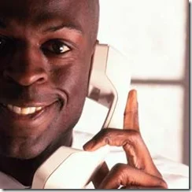

996lg

10. Things I don’t know anything about. (Translation: Things I would write in my “Things I give an Eff about notebook”) ☛ Them: “You going to the concert?” Me: “Oh! Who’s coming?” Them “Justin Beiber.”  Me:

9. Bad Breath ☛ This is self-explanatory … you could stay and chat but you’re a man talking to another man, also it would be rude to throw-up in some(1)ne’s face.

8. A chatting chatty azz man ☛ I’m a man … “Ladies look at your man, now back at me, look at your man again, now back at me …” men get in and get out of conversations. If a dude lingers too long in the “I’ma boy” zone when he’s talking to another man. Look for me to start riding a horse backwards.

7. Repetition ☛ Every time I see you, you tell me the same thing. Go fall off a cliff so you’ll have some new stuff to talk about.

6. A long azz, on again off again engagement ☛ Face it “He’s just not that into you” and you’re never gonna get the deposit money back. Me: “Oh Ya’ll pushed it back until the Spring (again?) … well keep me posted! Listen, I have to go, gotta take Rocky to the Vet.” Her: “You don’t have a dog.” Me: 0\_O

5. Conversations about Socialism ☛ Maybe I should listen … I mean with all your experience working the Frosty machine at Wendy’s. Unless you are a professor of History, Cultural Anthropology or Economics stop trying to kick knowledge son & go kick rocks.

4. Stop talking to me about the iPhone, iPad, iCar, iBoat ☛ \*Deep Breath. Shots Fired. #pow #pow #pow\* I don’t understand how I can admire a company soo much but hate them too. I won’t end the conversation, I’ll just provide tips on new apps that you should consider. Them: “I’m thirsty.” Me: “What? Your iPhone can’t turn the air into cool refreshing water? … There’s no app for that?”

1126\_icar\_inter\_credit\_700

3. Long Windedness ☛ Lil’ MrTramueL’s mother takes forever just to tell me that he needs some allergy medicine. Ms.Frenchie: “You remember the house where I grew up right? Me: “Yep. You’ve told me about it a  million times … can you make the long story short? You know how you do.” Ms.Frenchie: “Oh. Okay … Well, we used to have a window in my old bedroom, and my mama would leave it up at night so that ….” Me: “Places phone on mute. Walks away.”

2. People with American names who talk /sound funny on the phone ☛ Don’t ya’ll dare judge me! You know what I’m talking about … you call ***Apple*** support and Bob answers  but he sounds more like Madhav Kumar. \*Dial Tone\*

1. Carrying on side conversations ☛ Step away without a salutation or well wish and you get the dial tone. Your lil’ dyslexic child do that same stuff every time &  you feed into it! I’ma man, I’m only going to be a minute \*Pause\*  … tell lil’ Tommie to turn the book sideways and wait until you get off the phone.

0.5 (Number 3 Continues after 20 minutes) … \*Comes back to phone\* Ms.Frenchie:“ … the electrician had to install those three prong cords for the washing machine & the dryer …”

What drives you crazy on the phone? In person? At home … you get what I’m getting at! Answer the question!

Mr. “Give Up Conversation But Don’t Say Nothing” TramueL

\*Disclaimer\* *Nothing wrong with working the frosty machine at Wendy’s. Somebody has to do it. Having an American name even though you have a thick azz accent. Lil’ Tommie really isn’t dyslexic, he’s special.*
