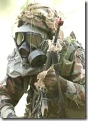

Eight months ago I was inspired to write a witty commentary on how s*ome* women in the workplace choose to wear battle fatigues and utility belts: “[Well Camouflaged](http://extroversionbelied.posterous.com/well-camouflaged)” That’s kind of dramatic but I wanted to grab your attention. I had a conversation tonight with (1)ne of the ladies that inspired the original post. {We are now “friends” on Facebook, but that in itself is a whole notha’ post} … so I’m talking with her about skin care because she sells Mary Kay and Mr.TramueL is trying to get his face right for his “Future” … anywho someone walks past wearing camouflage and I cut my eyes. She notices and the conversation begins:

Mary Kay: “Why did you lQQk at her like that?”

Mr.TramueL; “Like what? You mean with a side eye?”

Mary Kay: “Yes. She already thinks you don’t like her.”

Mr.TramueL: “I give out what I get.” “I’ve worked here for a long-minute and she can’t even make eye-contact with me. We don’t have to hold a conversation, common courtesy would be for her to acknowledge me, a head nod, a stanky leg, I would even except a racial slur or two, I’ma need for her to say something.”

Mary Kay: “At first I thought you didn’t like me either.”

Mr.TramueL: “I didn’t.”

Mary Kay: “Man! You so crazy.”

Mr.TramueL: \*Blank Stare\* \*Blink, Blink\*

Mary Kay: “I mean, I didn’t really talk to anyone in here because so many women are catty and guys are always trying to talk to me.”

Mr.TramueL: \*Blank Stare\* \*Blink, Blink\*

**… See Original Post.**

Live Well,

Mr. “Your Energy Can Be Better Spent” TramueL
