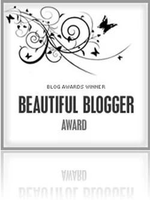

So my Blog is approaching the (1)ne year mark and rather than cheer for the Team of Me I decided to  spread some E-Love with my Fav Five Fab Women in the whole world, that’s right the whole world. I would like to thank each of them for being my willing conduit into the world of women. I wanted to do things a little different because I am me and I am nothing short of amazing, however, this isn’t about me it’s about them. They have shared emotional experiences, lend credence to normalcy and engulfed the blogosphere in flames. I’m gonna step back and allow them to introduce themselves.

[Goddess Intellect](http://goddessintellect.com/)

*“My name is Goddess Intellect I am a blogger, freelance writer and lifestyle guru (in training) from the city of Toronto.”*

*“Writing and sharing gives me a podium to bellow from that  I rarely get to stand on in my offline life. After over a year of blogging I’ve connected with so many amazing individuals with interesting stories to tell and lots of valuable knowledge to share. They encourage me to tell my own story, and bring my all to the table while learning to be a better me. Every time I write I feel a weight taken off my shoulders, words are my healing. The responses from my readers sadly enough, really make or break my day. With that said I enjoy the community aspect of blogging and am constantly striving to expand my online network through vlogging, Facebook, attending blogging conferences, guest blogging and now through Blogtalk radio.”*

[Miz Represent](http://readingwritingblogging.blogspot.com/)

Read Miz’s words here ☛ [Beautiful Blogger Award](http://readingwritingblogging.blogspot.com/2010/04/beautiful-blogger-award.html)

… and this is why she’s hot (in her own words)

***Why I write, share, blog?**
”I have been writing for as long as i can remember. Being a lover a books it just came natural to write out my feelings. First I wrote poems, then journaled, later moving into writing fiction. I started this blog with initial concept of journaling my experiences with becoming a small publisher. Soon, i started to talk about my life, one is not separate from the other, because no matter what you are trying to do, you will continue to experience life, and in that respect there will be many ups and downs.”*

*”Blogging has allowed me the freedom to express myself for the most part freely. My experience has overwhelmingly been positive, but along the way there were some instances that caused me to at time censure my thoughts and feelings. Why do i blog? Well, it's really quite simple, because i like reaching out to people. I like sharing ideas, discussing life, comparing experiences and eventually learning that we are not really that different from one another, in fact we are more alike than we like to admit. Well, that's it for me. So tell me FAM, why do you blog, or why do you read blogs?”*

SunnyDelyte [Spoken Words & Thoughts](http://sunnydelyte21.wordpress.com/)

*“A Lil About SunnyD:”*

*“Born and raised in Trenton, NJ. I was introduced to blogging by my big sis. She thought it would be a great way to vent some of the things in my head. After a couple of people commented, I realized that I wasn’t the only person who thought like me. (Meaning I wasn’t the only shot out person in the group..LOL) “*

*“Writing as always been my things since high school. That’s when I met Spoken Word (Poetry)… I wrote my anger out and it help the anger leave me. Writing VS Fighting…would do me good…because I was so self- destructive during that time. Writing help me control my anger issue and get to know me. Ever since then, writing and I have been in a long term relationship now. I can see us parting ways.”*

*“Sharing my words helps me get feedback and advice on how to handle the different situations in my life. I’m always looking for someone wise to share their wisdom. After all there’s nothing new under the sun, right? Keeping it real is the only way I know to keep being me…Sunny D.”*

[Ms.Nikks](http://nicoledanique.wordpress.com/)

Read Ms.Nikks’ words here ☛ [Beautiful Blogger Award](http://nicoledanique.wordpress.com/2010/04/27/beautiful-blogger-award/#more-1476)

(7)even reasons she Blogs …

1. *This is my outlet to get all the crazy out!  Trust me, I’m plenty crazy.*
2. *I’ve been tempted many times to erase the whole thing, but my blog fam inspires me on a daily.*
3. *I enjoy the feedback, various points of views, and openness that comes with/from the comments I receive.*
4. *I want world dominatio peace, lol no I want to inspire women and men to be the best them!*
5. *I do this to help better relationships between parents and children, friends, lovers, races, etc.*
6. *My friends won’t let me quit.  I do have a goodbye blog saved in draft.*
7. *I’m outspoken and I take no shit from anyone, sometimes I forget to say the things I want in the moment of a heated, Katrina-esque fury, so I take it to the blogs.*

[Je’Tara](http://jetaraspeaks.com/)

*“When I first started it was just a hobby. I wanted to express my thoughts on Alicia Keys/Mashonda and that's where it began. Then I began to enjoy what I was saying and doing, it began to mean something to me. As a songwriter, I always knew how to capture what others were feeling through music but blogging was totally different from what I was accustomed to. I had to start capturing my feelings towards certain topics. And that for me was exciting. Blogging has allowed me to let down certain walls that I had built. It allowed me to have a voice in my community. It honestly has helped me to learn that there is more to Je'Tara than I even knew was there.”*

*“The reason why I keep blogging is because people need honesty. I don't have all the answers to certain situations but I do have my opinions. I don't like things to be sugar coated. On my blog whether you are a celebrity or regular person if you do something that I feel needs to be touched on, I will do so honestly. Some topics I touch on are personal but many people may have dealt with them. If I can make someone say, "Yeah I get what Je'Tara was trying to say or I never thought about it like that" then I have done my job. I honestly have began to love this. I don't plan on stopping anytime soon either.”*

*“I want to be able to continue to captivate my audience. I also have a special spot for black women. I want them to know how special they are. I need them to know that they matter in the world and that through my blog their voices will be heard. I want them to know that I love them enough to give them post that uplift them. I also want to tell them the things we need to change and work on, to make us better women. “*

*”I am enjoying the doors that are being opened up to me. Through blogging, I have met some wonderful people and made some beautiful relationships with bloggers who have a common goal as I do. This blog has helped me to begin to brand Je'Tara. I have new sites in the works and it all started with Je'Tara Speaks. I have only been up since the end of December and I am grateful for the love I am receiving from fellow bloggers. I am loving the feedback I get from readers. So it started as a hobby and turned into something great. It turned into an outlet for me and a way to express my feelings. I hope that I can keep blogging in the future and that my post inspire people in some way. Thank you Mr. Tramuel for giving me the opportunity to share my story!”*

There they are! Thank you ladies!
