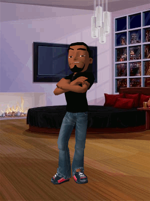

 
So I’m on my intelligently hedonistic tip commenting on my blog homie Sunny D’s Spoken Words & Thoughts post [“Light Skin Complex”](http://sunnydelyte21.wordpress.com/2010/05/06/light-skin-complex/) … I drop a little knowledge and walk away. My equilibrium was off so I retraced my interactions for the hours, days & week until I returned to find someone had willfully and rather maliciously destroyed balance in the TramueL™verse, I mean, ♬ I know way too many ♬ people than I did last year ♬ who the F is you?

The comments did not effect me in the way I’ve dramatically displayed above. It reads as if someone was out to destroy me … nah kid, I’ont study war no’ mo’. Honestly as I tried to explain the dis-connect between what she read and interpreted to what my response really meant. Other thoughts ignited a fire deep in my loins. Mr.TramueL is a peace enabler and before I continued on the path of least resistance I invited her to step outside, ‘cause I know some body snatchers. Seriously, (I do) but no really to take the debate offline instead of showing out all willie nillie on someone’s page. After a sharp warning that I was pretty slick with this here technology thang‘ & that if she tried to spam me, somebody was about to come up missing, I offered her my email address so we could continue our verbal jab’s offline. She would have to bob and use her weave.

She accepted and responded saying that she laughed at my “spam” comment. Her point (kinda) was that I was neither a dark or light skinned female so I could not offer an opinion as such. I explained that my response was not my view but a way to step outside of the typical thought process that someone was inferior and that there are outside influences at work.

Go read the post and comments. I’ll wait.

I want to preface this next section saying that I informed Gorgeous Puddin (That is the name that came through her email client) that I would be immortalizing her in a post and gave her an opportunity to respond  to my take aways. My first observation: The need for her to go soo hard for soo long \*pause\* I mean the need for so much detail? I did tell her that I would welcome it and appreciate it on my page, however, it was almost a mini post, she could have responded on her own page and linked to it. Mute point. She did answer this for me indirectly though. “*I normally don't comment on blogs outside my circle as you say, but race issues provoke me in such way, and because it is my field of study (b.a. Sociology and African American studies currently finishing masters in Education on to PhD.) i have to say something.”* Point taken. Which brings me to thought number two. Education & why she felt the need to bring it up soo many times? I said: “*The second point to jump out at me was your need to mention your education (Which I am very proud of as a human being that you have achieved so much and continue to thirst for more. \*Ovation\*) it is almost as if you are compensating for something. I thought it was irrelevant, your words showed your intelligence, besides University degrees don't guarantee intelligence.”  … “concerning the subject and nature of the post, again it makes me wonder about why it was such a hot topic for you. Maybe the situation was reversed? Instead of the attacking you were being attacked? Not enough love from the fellas in school? Did they prefer the lighter-skinned women?”*

So I didn’t receive a response (yet) from Gorgeous Pudding, the irony maybe that my e-mail is sitting in her spam folder O\_O. Tips to avoid BB (Blog Beef) Get the best out of your interactions. Play fair. Try to transcend differences, avoid pettiness & minor irritations.

Mr. “I know you believe you understand what you think I said, but I’m not sure you realize that what you heard is not what I meant” TramueL™

.
