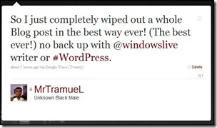
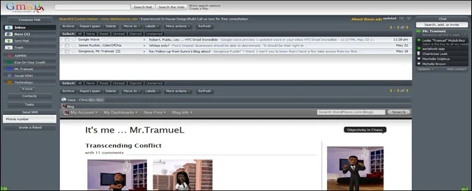
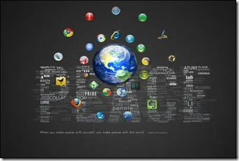

I had to create this award winning post all over again. I’m sharing with you technology tips however, I couldn’t recover my own post … any who!

This is part II to my my Nobel award winning piece [“The terrifying Acceleration of Interpersonal Communications Will Uglify All Hope for Human Psyche”](/unknown-black-male-1/2010/04/14/the-terrifying-acceleration-of-interpersonal-communications-will-uglify-all-hope-for-human-psyche) were I provided tools to simplify your life. This time ladies and gentleman I will share add-ons and plug-in to use as you are perusing the world wide web. I use Mozilla Firefox primarily so the following are available. Google Chrome may have extensions for most if not all of these as well, but we ain’t talking ‘bout them, we rolling with Firefox.

Cooliris Inc. has two that I use on the regular:

[CoolPreviews](http://www.coolpreviews.com/): If you have too many links to look through, the CoolPreviews browser extension opens a preview window to any link you mouse over when you point your cursor to an individual search result. A small, translucent blue box appears. Mouse over that and CoolPreviews pops up a floating window with that link's contents.

[Cooloris](http://www.cooliris.com/tab/#f=Channels) {Pic Lens}: Transform your browser into a lightning fast, cinematic way to discover the Web. This plug-in takes you to an expansive "3D Wall" that lets you browse thousands of images, videos, and more with ease and speed.

[Ad Blocker Plus](http://adblockplus.org/en/): The name says it all. This kills web ads in your web email client and on all of your social sites, it is seamless I don’t even realize it’s there until I’m on someone else's machine and see all of the ads, images, scripts and flash content.

[SkipScreen](http://www.skipscreen.com/): Never download music without it. This was created to skip unnecessary pages on sites like Rapidshare, Megaupload, zShare, Mediafire, and more.

This is not the actual logo, but I like it. #DontJudgeMe

[Power Twitter](http://powertwitter.me/): Designed to make the twitter experience more full-bodied. PT interacts directly with the twitter.com website & because it is embedded in the Firefox browser it is able to do some pretty slick things: Inline embedded media from Flickr, YouTube, TwitPic and others, expanded URLs so you can see where links might take you, twitter search and search results right on the page, peek - an avatar mouseover that lets you see recent tweets from that person & even status updates that are happening with your friends on Facebook.

Here come my favorites!

[Google Redesigned](http://www.globexdesigns.com/products/gr/): A complete redesign of popular Google services, Google Redesigned loads and manages several CSS stylesheets that change the appearance of popular tools. It has since grown to incorporate [Google Calendar](http://calendar.google.com) and [Google Reader](http://reader.google.com), and is slowly taking on other services one by one. I use it with …

      

[Integrated Gmail](http://integratedgmail.com/): Allows you to make the Inbox Collapsible and loads your choice of Google Calendar, Reader, Notebook, Groups etc... seamlessly into the gmail interface below the inbox (rather than the sidebar) using a collapsible box. It even supports custom URLs (with navigation buttons) and Google Gadgets. If your are inbox minimalist, you can enable minimalist mode to clean up the inbox even more. Works with Google App Accounts and Gmail Themes.

Here is a snapshot of my Gmail Inbox using both. I've integrated my Google Voice account and my Wordpress Blog.

My absolute Favorite!

[Circle Dock](http://circledock.wikidot.com/): The Circle Dock application was designed to help you launch your programs from a circular dock, drag and drop your files, folders, and shortcuts onto a circular dock that you can resize. Rotate the dock with either your mouse wheel or the keyboard arrow keys. Change the image shown for the icons and change the skins (compatible with icons and skins for Rocket Dock, Object Dock, etc.) The dock appears where your mouse is by pressing a hotkey (default is F1) or your middle mouse button, other options available.

I use it to keep my desktop organized and clutter free. Wanna see it? here it go …

This concludes my portion of the show folks, nothing else to see please move along.

Magic Always,

Mr. “Be You (tiful)” TramueL™
