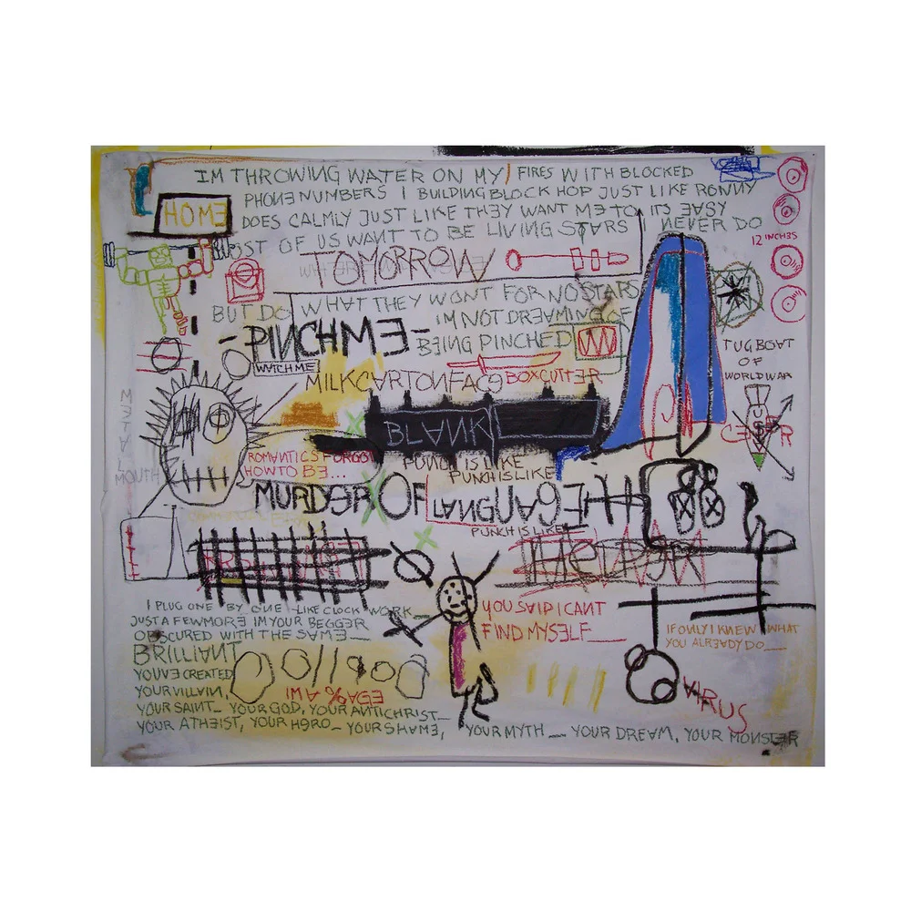

**What Are They?**

Every single piece of information you are exposed to is run through a complex set of filters before you decide what, if anything, to do with it.

This causes you to unconsciously delete, distort and generalize information according to a number of things such as your meta programs (these are the things you are born with that are hardwired such as a tendency to be optimistic or pessimistic) beliefs, values, attitude/mood at the time etc.

You have no choice but to do this because you’d go insane (even if you had the mental capability, which you don’t) trying to judge every single thing on it’s own merit.
