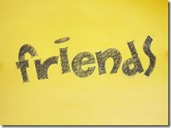

Friends

\*Clears throat for speech\*

I don’t know where to begin so I’m going to share how my “be you (tiful)” mind bought this post into existence. It’s a few weeks old and has been sitting in my drafts folder quivering like a frightened child with the fear of being scolded by a parent. {Where is D to the Y? Where is Dez? Where is DJ?} ☚Insiders

I’m on Tweedeck with columns for Twitter, Facebook, Google Buzz, LinkedIn & FourSquare all in view. The word “friend” was lighting up and jumping off the screen towards me from each. Some praised their friends while others contemplated if someone was ever really their friend. So I stopped and I asked myself, I said: “Self? How do you define a friend?” Myself said: “I’ont know kid, I’ont wanna study war no’ mo’.”  I mumbled: “T!his guy.” … I think the force was strong with the Blog circle that week ‘cause it spawned a few post on or pertaining to friends.

C.S. Lewis categorizes a four letter word beginning with L and ending with E into four basic human loves: Affection, Eros, Charity & Friendship, of the four friendship is probably the least valued and most underrated. The reason is that many of us have not experienced a substantial, enduring friendship. I have over six-hundred “friends” on Facebook & three-hundred “Followers” on Twitter. These relationships involve nothing but a tweet and a status update, just a passing connection … another reason friendship is devalued. We say associates and acquaintances from work are friends, from these relationships a friendship may grow but it doesn’t have the trust, loyalty, commitment or intimacy of **true** friendship. The other night while speaking with a conversance they shared feeling alone, identifying the fact that from within their phone’s contact list there wasn't anyone they could call at 10:00 p.m. on a Saturday night. I’m sure they have “friends” but they weren’t clocked in at that particular moment. Aside from my sisters, a cousin, my parents and the women I’ve dated, I’ve never had a **true** friendship. I’ll minimize that by saying I’m not holding a casting call for any friends because I’m an introvert. Connecting with others is a process, the flow involves questions, inferences and conversation. The problem that I have is that most friendships start from the value of it’s usefulness, achieving some material end or as folk to kill time with. My standard of folk and my actual expectation keeps my from reaching out. I understand that this is a problem and I’m working through (My therapist says only four more sessions at an extended rate & I should be ready to hold a casting call.)

So after talking & hugging it out with Mr.TramueL our definition of friend would be someone who supports my emotional, physical, intellectual and spiritual development. Someone who doesn’t want me to stay as I am, they want me to grow, they want nothing less than my wholeness & my holiness.

There is so much more that I could say but I won’t, I’ll allow you to speak on what you see as **true** friendship?

Magic Always,

Mr. "One day, someone will walk into your life and make you see why it never worked out with anyone else" TramueL
