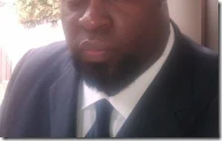

Interview

My writing process is generally born from my observations of the world around me, life and all of it’s ironic twist. Often transcribed as my attempt at levity of any given situation. I use wit and sarcasm to fulfill a psychological need (fantasy) because my will is directed inwards, often times I try to find a path for it, a path that will allow me to "get away from it all" at least some of the time. T(!)his is generally why I go way off into left field of the point I want to make in my post sometimes most times, so today I’m going to give it to you up front. The point that is. Bad Boy Baby #TakeThatTakeThat

My observations may appear as sharp, insulting or that I’m making light of a particular situation. When in reality I’m trying to assign meaning to what others might consider "ordinary" events. It is so completely natural for me to accept that there is more to the world than what is before my eyes.

**“Team of Me” – The Point**

I’m not a do-gooder nor am I a law-breaker. However, I’m not afraid of the "dark side" of human nature and will bend the rules from time to time if needed. I’m an introvert and it is more apparent to me now more than ever. Via forbes.com  … Thinking first and talking later (Check), focus on depth (Check), exude calm (Check), prefer writing to talking (Check), embrace solitude (Check). It’s a gift and an “opportunity” for me when it relates to …

**Friendship**

The Gift: I’m a giver & usually quick to help others, not only with er’day common task such as help with a move, sharing information & taking yo’ mama to the store, but also on a spiritual or psychological level.

The Opportunity: To counsel using God’s word. What I’ve found is that most of my thinking is related to HIM, I just never give HIM credit. Thus …

**Spiritual Growth**

The Gift: I take particular pleasure in growth and life's lessons. I’m an eternal student, so I am constantly transforming, evolving, and seeking a deeper relationship.

The Opportunity: Although I seek God’s love, sometimes I run from it. God is light, the fear of His Energy Star CFLs rated bulb shining on all of the things that are defaced or concealed in me brings realness to my conscience and how I perceive things. {This is a whole ‘notha post} The point: To have God become closer to me has meant facing up to the things about me I don’t like or want to see.

**Love**

The Gift: I don’t like to brag, so I won’t.

The Opportunity: Learning to receive. We can define, debate, quote, reminisce and site examples of what a four letter word beginning with L and ending in E is or should be, but if we are not open to receive. Null.

\*The Close\* I can be emotional to the point of irrationality at one moment, and logical the next. How to blend my head and heart is a constant struggle. Moodiness {It’s complicated … my tendency to over analyze can give the the appearance of emotional detachment} and an extremely subjective nature makes me prone to hypersensitivity, which usually has to do with the fact that I take in so much from my environment. ☚That gives you Mr.TramueL’s Observations. Which takes us back up top & starts the writing process.

Mr. *“I took time out to really emote and understand my own thoughts & may end up baffling others”* TramueL
