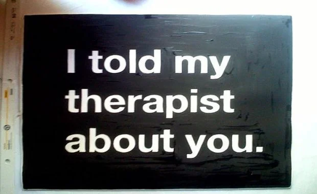

Water cooler talk:  The Weather, The Weekend, Father’s Day, Beautiful Women, Children, The Lottery …

Them: “Money can’t make you happy”

Me: “I just want the chance to prove that theory wrong.” I’m just playing, unless I win.

The conversation progresses past my need to be witty, I was trying to hide the fact that I haven’t acquired a taste for this person.

Them: “What would you do with all of that money?”

Me: “Educate myself, travel, take care of my family & do God’s work.”

Deep bows, I’m sorry but I wanted to pull them in. The reason I may have not acquired a taste for this person is because of a recent conversation about “safety” “hood terms” “myths” & “stereotypes.”

\*1…2…3…Break\* I’m fitna’ {ATL shawty!} get in trouble because I’ve been labeled as “aggressive” {not their word but the best way to describe it} by someone I “Four Letter Word Beginning In L and Ending In E” this is someone who’s approval I desperately seek but seem to vex with some of my observations.

\*Blue 21, Blue 21, Hut, Hut, Hut\* I’m not an activist, but I am aware of my environment and the effect that it has on me, you, us. Today I coin the phrase “Observationalist” – To make aware and influence by the thoughts and ideas based on social, economic and cultural background. Now … Hip somebody else.

Of Safety, Hood Terms, Myths & Stereotypes

In an effort to not be “that guy” the person with whom I haven’t acquired a taste for tried to assimilate and associate with the masses by speaking negatively of & on what folk perceive as poor neighborhoods. Having lived in most of the neighborhoods in question I felt it was only right to be “that guy” and educate. “They either don’t show, don’t know or don’t care about what’s going on in the hood.”

“Those neighborhoods” … yeah they care about property values too. Yeah they care about their community too, yeah they care about empowerment too, yeah they care about opportunities for youth too. \*Fast Forward one of their comments was about criminals, criminal activity, to which I sarcastically responded crime effects everyone and no community is immune from it, but I digress … the point in one of my teaching moments was that folk return from jail and are treated unfairly, we take away their right to vote, deny them housing and discriminate against them with regards to employment.

The wrap up: (1) What I would do with the money? Work with the city, county, Sherriff’s department to break the cycle for offenders. Develop youth programs, mentoring programs and scholarships. They gotta eat or they might hit someone over the head. God’s work? (2) Interestingly enough I told the person with whom I haven’t acquired a tatse for that they were criminals, we are all criminals, we have never gotten caught. What if you got caught smoking that ooooo weeee! you serve your time, get released but you couldn’t rent an apartment, you weren't able to vote, and you lost your dream job working the frosty machine at Wendy’s?

Man this is long! I’m freestyling ‘cause I’m at work.

Translation: 8 Weeks of training.

Translation: Google Reader ‘cause they block me from tweet’n and you know how much [I love Twitter!](http://nicoledanique.wordpress.com/2010/06/20/yours-truly-pt-iii-i-used-to-love-her/) Shout out [Ms.Nikks](http://nicoledanique.wordpress.com/)! Shout out Buzz Can Tweet!

Oddly enough look what I found a day after the mis-education of someone I haven’t acquired a taste for ["I'm a criminal and so are you"](http://forensicpsychologist.blogspot.com/2010/06/im-criminal-and-so-are-you.html "http://forensicpsychologist.blogspot.com/2010/06/im-criminal-and-so-are-you.html")

Live Well,

Mr. "That Guy" TramueL
