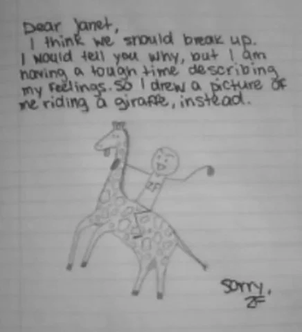

BreakUpGiraffe.jpg

Not So Random Chick: “Mr.TramueL I’m through! What’s the best way to tell him it’s over?”

\*Flashback\* To the best way I’ve never been dumped. Okay, check.

Mr.TramueL: “I think you should do it during the day, preferably during lunch, in a crowded place, drive separate cars and give the speech ***after*** you eat. {I was mad hungry and wasn’t so lucky, the death grip to my testicles was delivered before the meal!} … so don’t be cruel Bobby Brown, let them enjoy that last meal.

I’m not a real therapist, but I  play a representative of advice & counsel in real life. Two separate and unrelated conversations prompted me to write. One up top and …

Not So Random Dude: “Mr.TramueL I met you how long ago?” “You don’t have somebody you seeing?” “You still doing that five year and out isht?” {All rhetorical I assume ‘cause he didn’t allow me to respond}

Mr.TramueL: \*Blank Stare. Blink.Blink\*

**The Detached Observer**

Background of Not So Random Chick is that she allowed a man to take up residence literally and figuratively while he struggled with employment, child support and “mother of his child” issues. All the while she is holding down the fort without asking him for nay thing’

Not So Random Dude would go on to say that life is too short for any man to spend without a special someone in their life. The dichotomy between the two situations is *need*. As much as a woman needs to feel she is loved, a man needs to know he is needed|respected. For a man it can be emasculating when he “feels” that he is not respected or needed. I said feel. {Ya’ll are tuff}

Naturally she called bullisht, but I explained that I wasn’t offering an excuse … I mean she asked me "Why is he showing out?" Mr.TramueL’s Observation: Although she expressed love by taking care of him, supporting him and giving him the bizness, in his mind he feels that  she didn’t meet or fulfill the “need” of being needed. He probably went somewhere to play captain save-a-hoe.

Experiential Schooling,

Mr. “I might catch some heat over this” TramueL
