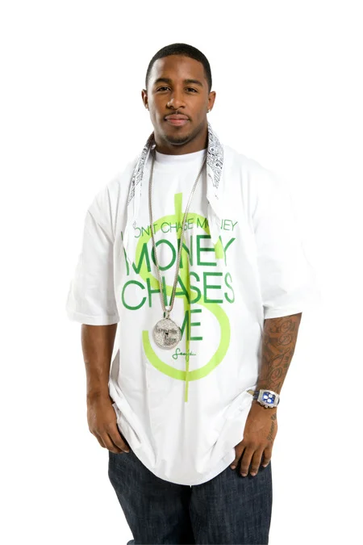

[See the full gallery on Posterous](http://eyetramuel.posterous.com/corporate-vs-the-streetz)

So I’m back in Corporate America and I remember why I had a calm sense of peace about myself two years ago when I received the tap, the talk and the package. “Workforce Reduction”

Business jargon, buzz words, acronyms, phrases, functional and non-functional cosmetic job title’s all kill me. Kill me.

“Bubble Up”

Corporate: Escalate a situation to someone with more authority than you. Dare to be average.

Streetz: From the process of cooking crack. To become wealthy at a rapid rate. The come up.

“Casual Friday”

Corporate: A day to unwind from the grind of “business casual” through the week.

Streetz: A day to unwind from the grind.

“Team Meetings”

Corporate: The BIGgest waste of time. Where things don’t get done.

Streetz: An outing at the club, bar or someone’s house to discuss all things creative. \*Wink\*

“’Shoot Me’ an email”

Corporate: To create an email outlining the discussion which you didn't have time to discuss.

Streetz: I would advise against saying anything with the words “shoot me”

“The BIG Picture”

Corporate: Understanding of the complete business model from a holistic perspective.

Streetz: Understanding of the complete business model from a hustlers perspective.

“BOSS”

Corporate: Back Office System typically found in financial institutions.

Streetz: A person who is a leader, someone who runs things in his/her city.

“CEO”

Corporate: Chief Executive Officer

Streetz: Anyone with a business card {Vista Print} and an idea or dream.
