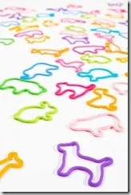
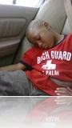

Silly Bandz - Rubber band-like figures that are worn as bracelets, and can be made into shapes like animals. Immensely popular among elementary-aged school children.

I’m Mr.TramueL and I wear Silly Bandz. Admitting is the first step.

So every morning on my way out the door I take great care to grab my cell, watch, bluetooth stereo headset, my pocket armor {A shield my mama gave me and a bookmark with my favorite scripture on it}, any loose change, my books and last but not least my silly bandz.

Folk recognize them and ask what they are or laugh in amusement that a grown man is wearing them, an associate even asked why … “I thought they were for children?” I told her I would get back to her.

**The BIG Get Back**

Little Mr.TramueL had me drive to four Walgreens, Books-A-Million, and some snoody-ta-doodie {Oh they fancy huh?} toy store in the middle of the night so he wouldn’t be the last in his class to have them. {The things we do for our kids} But he is so handsome, add the fact that he looks like me … I had to please myself. \*Pause\*

I like to take his silly bandz while he’s asleep

Fathers must understand these critical needs of every child

1. Loving Discipline
2. Unconditional Love
3. Anger Management
4. Protection from the harmful influences of our culture
5. Knowing God

Father’s Day was another opportunity for me and self-analysis, you see I hadn’t heard from my daughter and both boys were with me. My teenage son didn’t utter one word about Father’s Day but little Mr.TramueL had given me a father’s day painting a few days earlier. He also {without a prompt from his mother} told me Happy Father’s day. Told me he & BIG bro were taking me out for dinner but I would have to pay. 0\_O

I’ve always thought of myself as a pretty good father. I provided for their  material needs, did all of the for “show”  things but must admit that I’ve failed at giving focused attention and fulfilling their emotional needs. Spending enough time that they thought they were the most important people in the world to me. {Which they are} Finding time to focus on my children has been and is one of the greatest challenges of parenting. I wish that I recognized this earlier with respect to  my daughter and first son, which probably explains why they only seem to reach out to me when they need something. I remember being that age and wondering why my parents didn’t provide for my material needs, it was because they were taking great care to provide for my spiritual needs.

I wear the silly bandz because little Mr.TramueL gave them to me, he makes me feel like I’m the most important person in the world. His unconditional love, shows me how to love others despite my sins, shortcomings and failures.

Magic Always,

Mr. “Transforming through my opportunities” TramueL
