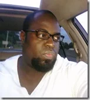

Traffic Light

I’m getting the hang of posting from my cell phone via e-mail. The title suggest that I’m texting while driving, however I was safely pulled over at the time of this writing. I mean to have done so would not have been prudent, not at that juncture.

**Random Observations  About Nothing & Everything**

I thought about a conversation I had with a “Princess” at work the other night, she is a very attractive twenty something who has caught the attention of an older gentleman whom she has no interest. Her words: “Man, he’s about your age!” \*Ouch\* “He sent me a text at 6ix a.m. … I’ma need him to not be thinking about me that early.” I responded with uncontrollable laughter. Maybe you had to be there.

Small Businesses are suffering during these trying economic times. I could choose which dry-cleaner to drop clothes off, now it seems they’ve all but disappeared. The 2wo near my home, the 1ne near my barbershop. Null.

There seems to be a switch in the number of sustainable relationships among some of my non-love relationships: family, work and friends. Maybe during the summer people don’t wanna be attached? Anywho … I’ve notice that the stages after an initial break up never seem to vary from the script: At first there is the realization,  actual realization, denial and bitterness before they move on. Right now everyone is holding in the actual realization phase. I can’t wait for what unfolds in the bitterness stage! Somebody might come up missing! {Yep. A.W. & C.C. I’m talking ‘bout ya’ll}

I thought about a meeting the other day and the facilitator was yielding a mighty weapon. Im’a need you to know the difference between ask and axe.

Mr.TramueL’s Law: Anything that begins well will end badly.

{Note: The converse of Mr.TramueL’s law is not true}

Live Well,

This has been a TramueL Truism presentation.
