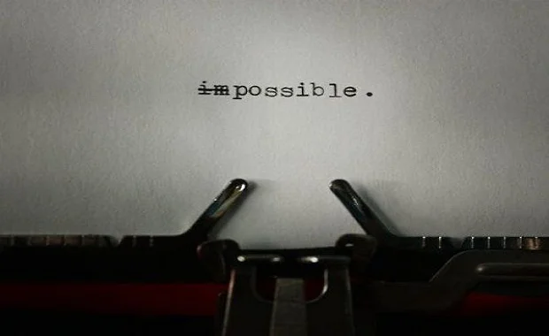
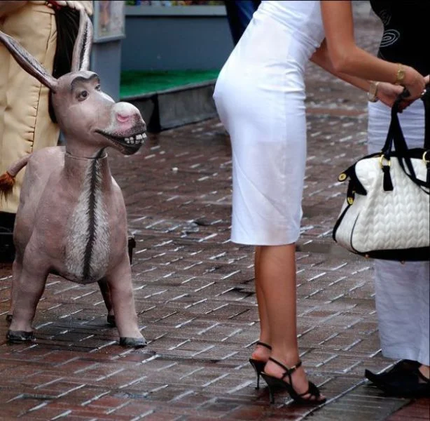

It's Not Impossible

Yeah I cringed writing the title but I wanted to pull you in. I mean we all love baby mama | baby daddy drama right? Don't answer ... It was rhetorical.

I don't believe I have one girl friend or male friend that has a positive or perhaps the word I should write is "good" working relationship with the co-author of their children. That's the expectation right? Constant infighting, bickering, name calling, discussions concerning C.R.E.A.M. I'm not talking about the white stuff that created the kids ... I'm talking about money. {Cash.Rules.Everything.Around.Me} The most common issue » non-payment or over payment of child support.

It's not impossible, but possible to have a good working relationship.

What happens when there is a good working relationship? ... again, don't answer. I consider my relationship with Lil' Mr.TramueL's mother to be such. Sure we "dis-agree" but it's generally about dumb stuff.

My Argument: "Why did you only pack one pair of his drawz?"

Her Argument: "Why did you leave me?"

I'll admit that I may have gotten out of pocket with fulfilling some of her request during our initial break. We didn't end badly, we just ended. It took observations by friends that are girls to enlighten me, be willing conduits into the world of women who date men with kids. I challenged their perspective citing examples like Bruce & Demi, Will & Jada ... Naturally they responded with bullshiggity. Who am I to place myself in the company of rich white folk and rich black swingers? ... again, don't answer. I'm progressive enough to understand the dynamic of inter-personal relationships with ex(s). With out going into detail, I've been challenged. That theory has been put to the test and I didn't fail, it was a genuine acceptance of "her" ex, their relationship and their relationship concerning their kids.

The greatest gift a man can give his kids is to love & respect their mother. That love & respect translates different(ly) from different perspectives. Our "friendship" involves a bond of love, not an obligation of it.

I hope the future Mrs.TramueL is progressive enough to understand.

Mr. "I knew it was over when I looked at her butt, but didn't get excited" TramueL

Donkey aka "jackass"
