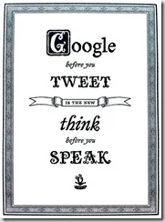

media\_http24mediatumb\_cHpAE.jpg.scaled500

Dictionary of Modern American Usage defines “skunked” as “When a word undergoes a marked change from one use to another . . . it’s likely to be the subject of dispute.”

Example: *Hopefully* means *in a hopeful way*, not *I hope*. It’s the paradigmatic example of a skunked term.

Class.

I know skunked is defined as a “word” but It’s Me … Mr.TramueL and I don’t follow trends, I set them.

**Mr.TramueL’s top ten & ½ irritating *phrases* that ‘cause folk to get sprayed up by a skunk …**

**10» With all due respect:**

Mr. Dennit: Ricky, your little obscene gesture is going to cost you 100 points. Do you know how much that costs us in sponsorship dollars?

Ricky: *With all due respect*, Mr. Dennit, I had no idea you’d gotten experimental surgery to have your balls removed.

Mr. Dennit: What did you just say to me?

Ricky: What? I said it with all due respect!

Mr. Dennit: Just because you say that doesn’t mean you get to say whatever you want to say to me!

Ricky: It sure as hell does!

Mr. Dennit: No, it doesn’t!

Ricky: It’s in the Geneva Conventions, look it up!

**9» I could care less:** I believe what most people mean to say is that they *couldn’t* care less … but who am I? You probably could care less.

**8»****At this moment in time:** WTF? … Do you mean right now? or no maybe you mean now?

**7»** **‘Cause up North:** \*Deep Breath\*

Them: We’re can I find a good Deli down here? ‘cause up north it’s one on every corner.

Me: Blank Stare. Blink. Blink.

**6» Can I ask you something?** I allow one question and you’ve already asked. No.

**5» No, its not that:** Then what is it? You’ve spent the last hour telling me exactly what it is & when I respond using your exact words & phrases co-signing it you say … “No, its not that”

**4»  You know what I  mean?** Too easy. *It’s not rocket science*

**3» You know what I’m saying?** Even easier. *But that’s neither here nor there.*

**2» Basically:** The equivalent of Um, I’d rather hear you say Um fifty times than to hear you use this useless qualifier at the beginning of every sentence.

**1» At the end of the day:** I thought this verbal crutch was only used by NBA players turned commentators and students giving unprepared synopsis after a long weekend of partying. But when I heard G. Dubya use it … I was too far gone, it’s over, we gon’ make this phrase light up « D.R.AK.E. references “Do Right And Kill Everything”

**½»****Stop putting that lower case (i) in front of everything.** Programmers and developers for Apple haven’t created an iLove app … yet. I know that’s not a phrase but  iCan’t take it anymore. My eyes hurt.

Radiant Silence,

Mr. “With all due respect, I could care less at this moment in time ‘cause up north I can ask you something, you know what I mean? you know what I’m saying? Basically, at the end of the day you shouldn’t of done it. But that’s neither here nor there. Going forward, I absolutely expect fairly unique apps from Apple, it’s not rocket science its the same difference “ TramueL
