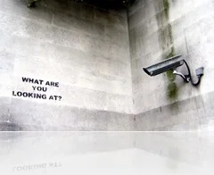
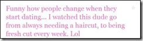

WhatAreYouLQQkingAt

I’ve been extremely busy working full time, part time and trying to establish TramueL Consulting {Controlled Emotional Response}  add the stress & shade from starting a new job {the full time position} but that’s not the point. All of that to say sorry I haven’t been commenting & providing my intelligently hedonistic thoughts all up on your page. I’ve even neglected my standard bi-weekly post.

 … any who I felt compelled to share my observations because I’ve been receiving the same message delivered in different formats. I guess that means I should share …

**Twitter**

Tweet

\*Shout out to @Scrumptious1 if she ever reads this

**Personal Conversation**

{Paraphrased}

“I’m not looking” “I’m going to focus on me and mine” “Relationships are too complicated”

**Observation**

Why do we reinvent ourselves when a relationship begins? We buy new drawz, shave {for men beards, for women … never mind} fix our hair, hide relatives sometimes kids Chris Rock quote: “We send our representative” Men lie about resources, women lie about what they want. Science proves it. Class.

Why do we reinvent ourselves when a relationship ends? We eat better, start exercising, buying new things “in with the new, out with the old” right? Eat right. Feel good. Look great. New friend. Complacency. Repeat. The end.

**Do As I Say Not As I Do**

Do those things while you are in a relationship, encourage each other, support each other. Why won’t you be great together? Hold each other accountable … just a thought.

Mr. “it’s very late & I’ve been at work since 10 a.m. so ignore this weird post” TramueL
