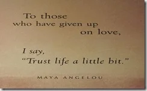

# **The Week of Loss, Life, Lust & Love**

## **Of Loss**

I’m not an empath but this week has proven that we all are on some level, for most of us it is so low key that we aren’t aware of anyone else's feelings but our own. I’ve had friends lose their mother, a very special friend who’s mother had a heart attack and a close friend whose dearest friend suffered a stroke. Although I did not know any of them personally, in the moment you first hear, the initial shock leaves you stunned, numb to the huge surge of feelings. I never know how to respond, the most common phrases are void of sincerity to me. So here are my words. Sorrow serves as a reminder of the brevity of life.

## **Of Life**

The greatest gift of life is to spend it for something that will outlast it … Listen for the voice that calls you. Legacy.

## **Of Lust**

My adult life has consisted of long term relationships so I’ve never been without release or recoil. {Stay on your toes} My sexual story has produced feelings of pleasure, pain, anticipation and dread. They expose a battle with foolishness and ill motives. Sex can be looked at as a loving expression or overcompensation for our real {or imagined} inadequacies. If love is blind then lust has 20/20 vision.

## **Of Love**

We had extraordinary chemistry … on the same journey for spiritual, mental & physical growth. Null.

Capital G’Dizzle made men & women different in the way we act, think and respond. That’s all I’m going to write about that.

*Love Ever since the first moment I spoke your name From then on I knew that by you being in my life Things were destined to change cause......*

*Love So many people use your name in vain Love Those who have faith in you sometimes go astray Love Through all the ups and downs the joys and hurts Love For better or worse I still will choose you first*

L.O.V.E.

Mr. “Yielding in Order to Overcome” TramueL
