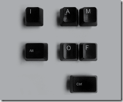

zoom

**Depending on someone.**

I’m usually reserved when it comes to asking others for help. I don’t know why … the subject is probably the discussion for another post, so when I do ask it’s usually because I really need it. The problem for me looking for someone to “carry” me is that I always get dropped.

I like the fact that I have only a few that I can depend on, I dislike the fact that it’s only a few.

**Talking to someone.**

Here comes the introvert again. I really am energized by spending time with Mr.TramueL but there are times when I need /want conversation, no thank you to the celebrity gossip and no I don’t want Einstein’s theory of relativity. I appreciate a happy median. I know it’s time for me to find an outlet when my mama tells me after 15 minutes that she really has to go. I’m the DJ, they’re the rappers, they do all of the talking while I listen and produce the track. Always the DJ never the rapper.

I like that I have friends that can hold a conversation, I dislike that I have friends that can hold a conversation.

**Listening to someone.**

I don’t know what it is about me that make folk wanna open up and tell me all of their private times & the whole nine. In line at the grocery store, at the gas station, walking up the street  … I am a magnet. Muted but direct, give up conversation but don’t say nothing.

I like the fact that I’m able to impart my impractical wisdumb, I dislike the fact that it’s with total strangers.

**Watching Good Times.**

My schedule allows me to watch a little television in the mornings, rather than start the day with the news (depressing) or sports I choose to watch sitcoms or a network series. Good Times were anything but. 1ne episode in general has JJ looking to "wife" a teenage girl that was totally PG, not in a movie but like Mary was with Jesus. I would have like them to talk about protected sex and choices (adoption) rather than abortion right off the bat. There were a few other random TramueLism's that I observed, but that's all that I will write. The end.

I like the messages that the writers execute on the show, I dislike the messages that the writers execute on the show.

**Working for someone.**

I’m happy to be (RE)gainfully employed however there are far better ways to make a living than indentured servitude.

I like the fact that I am able to exist. I dislike the fact that I am only able to exist.

*Mr. “ Amicability and Animosity” TramueL*
