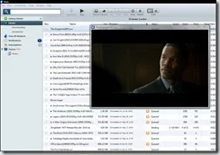
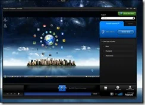
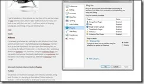
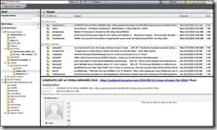
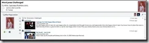

I had to break away for a minute, my last four or five post have been all emo and I’m a man. That’s right “ladies look at your man, now back at me, sadly he is not me” … I will now return to burping, passing gas, scratching, lying and drinking beer.

[Vuze](http://www.vuze.com/)

Self Proclaimed “… the most powerful bittorrent app on earth”

From Vuze: “Vuze is the most powerful bittorrent software application to Find, Download, and Play HD video content on the Web. With the latest release, you get powerful new search capabilities, along with the ability to play your HD videos on PC, Mac, iPhone, iPod, Apple TV, Xbox 360, PS3, PSP, and Tivo. Our award-winning P2P bittorrent technology enables users to quickly and easily download HD video with a single click.”

The player is incredible with lightning fast downloads … if you choose to download copyrighted material be sure to use “neighbornet” just in case they track your ip address.

[Pixtell](http://www.pixetell.com/)

Quite simple this is show and tell visual messaging.

From Pixtell: “Pixetell is all-in-one video messaging and collaboration software that lets you quickly add voice, screen recordings, webcam, and video to email or electronic documents. Video messages are shared through secure private delivery or exported to social media platforms such as YouTube and Facebook with the click of a button.”

[Writerous](http://writerous.codeplex.com/)

I’ve already proclaimed my undying love for Windows Live Writer and you already know I started Blogging using Posterous. I haven’t let it go and use it primarily for quick post about nothing but yet everything. By default Windows Live writer doesn't allow publishing directly to posterous.com, however, using the writerous plugin you can enable this feature. It’s already dead simple to use posterous, but this allows you to step your game up. Addicted to Posterous? Here you go.

**Microsoft Outlook {Social Media} Plugins**

[Twinbox](http://www.techhit.com/TwInbox/twitter_plugin_outlook.html)

You already use Outlook to manage your contacts, calendar, and e-mail. Twinbox is a free plug-in that adds a Twitter toolbar in Outlook. A click of the toolbar is all it takes to send out your own update, send a direct message, reply to a message, or (re)tweet something. Twinbox cleverly auto-shortens long URLs via TinyURL, it also shows you a preview of new tweets as they arrive, which saves you having to switch to the tweets folder every time you want to check for updates.

[Outlook Social Connector](http://office.microsoft.com/en-us/outlook/outlook-social-connector-partner-listing-FX101812910.aspx)

“Click on a contact’s name to see email and attachments he or she has sent you, meetings you have attended together, and their activities in social networks. You can also send this contact a request to become your connection in [popular social networks](http://office.microsoft.com/en-us/outlook/redir/FX101812910.aspx?CTT=5&origin=HA101794273).”

Harm None,

Mr. “The only person to ever ace a Rorschach Test” TramueL
