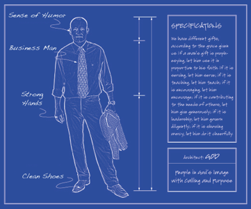

**The Week of Influences**

Currently Reading

The Blueprint "A Plan for Living Above Life's Storms" - Kirk Franklin

On Sociology and the Black Community - W.E.B. Du Bois

Raising Fences "A Black Man's Love Story" - Michael Datcher

A thought was born from my reading, emails, phone conversations, random observations about nothing , yet everything and then ... great friend(s) ask great question(s).

***"Ever wish you could (re)wind time and do something a little different?"***

We've all been asked the question, initially your right brain kicks in with something about not being caught with Kim under the stairs with your penis in her hand or reliving dreams of being the President of the World. The whole World Craig. I've had time to reflect and I would like to answer now " September" « That's my new name for you.

I wouldn't change any specific event, everything I've experienced has turned me into the person I am. I would change the way I p(re)acted and (re)acted to those events.

***Honest about what I really want***

I would not have distorted the truth about what I really want. I would have weighted more heavily the cost and benefit of said honesty.

***Self-sacrifice***

I would have been more aware of sacrificing my personal interest, things that I love for the supposed benefit of others.

***Resentment is born from deprivation***

Depriving myself of those personal interest, I subconsciously blamed others for my non-happiness, developing feelings of resentment towards anyone who participated in my non-happiness. I would change not making others responsible for my happiness.

***Neglecting others. Be cognizant of it***

I have someone that I am completely honest with about everything. Everything. I have no doubt that they would do anything in the world for me. The world. Yep, they said something the other day that resonated with me and caused a shift in the TramueLverse. Minus the curse words, the thrown knife, the scratch on the hood of my car & the death threat they said "*I'm sick of you talking to me like this ...*" This wasn't a love interest or someone with whom I wanted to lay horizontal with. You really don't need any more detail for me to make my point, which is ... I would change the way I've treated those who have loved me unconditionally. Science.

Harm none,

Mr. "*Science is true, don't be misled by facts*" TramueL

Posted with WordPress for BlackBerry.
