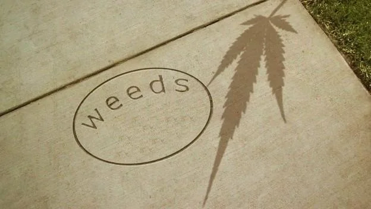

**Little Boxes** by Malvina Reynolds
[Listen on Posterous](http://eyetramuel.posterous.com/my-favorite-song-in-the-world-the-whole-world)

Little boxes on the hillside,  
 Little boxes made of ticky tacky,  
 Little boxes on the hillside,  
 Little boxes all the same.  
 There's a green one and a pink one  
 And a blue one and a yellow one,  
 And they're all made out of ticky tacky  
 And they all look just the same.

And the people in the houses  
 All went to the university,  
 Where they were put in boxes  
 And they came out all the same,  
 And there's doctors and lawyers,  
 And business executives,  
 And they're all made out of ticky tacky  
 And they all look just the same.

And they all play on the golf course  
 And drink their martinis dry,  
 And they all have pretty children  
 And the children go to school,  
 And the children go to summer camp  
 And then to the university,  
 Where they are put in boxes  
 And they come out all the same.

And the boys go into business  
 And marry and raise a family  
 In boxes made of ticky tacky  
 And they all look just the same.  
 There's a green one and a pink one  
 And a blue one and a yellow one,  
 And they're all made out of ticky tacky  
 And they all look just the same.

**Malvina Reynolds -** *Music from the Original Series* *Weeds*

