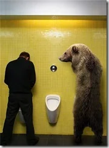

Hahahaha I came across this “note” that I was tagged in on Facebook. Found it whilst I am preparing to delete my Facebook account.{Deleting pictures and notes before I hit the delete button} It’s amazing the sayings, quotes & idiosyncrasies that I’ve carried with me over the years.

by [Brian Bae-Bae Tramuel](http://www.facebook.com/profile.php?id=713777906) on Sunday, March 8, 2009 at 6:18pm

1. My ex.... I'd like to sing you a song now about her. It's called, "They'll Find Her When the Leaves Blow Away 'Cause I'm Not Raking 'Til Spring."

2. Maybe I should.....begin writing my unauthorized autobiography.

3. I love......my family, music, books and technology.

4. People would say that I.....am aesthetic, sensuous & harmonious.

5. I don't understand.....people who say life is a mystery, because what is it they want to know?

6. When I wake up in the morning.......I thank GOD for blessing me, then I pray, when they die, cartoon characters have to answer for their sins.

7. I lost....... hope; the terrifying acceleration of interpersonal communications will uglify all hope for human psyche. (I is Intelligent)

8. Life is full of......ironic twists that sometimes startle us. Ex: Taking a laxative and a sleeping pill at the same time.

9. My past is......full of wonderful memories and learning opportunities that I've grown from. Although there is one memory I would like to forget ... Northwest Elementary School song "Northwest, Northwest old dear and faithful we will all be true, your hopes, your dreams and inspirations will always see us through!" I CANT STOP SINGING IT!

10. I get annoyed when......I'm reading a book and falling asleep, I'm reading, reading . . . and all of a sudden I notice my eyes are closed.

11. Parties are.....the moral and intellectual crisis of our time! Do I wear jeans, sneakers and a button up? or get suited up? ... Well maybe I should match what she is wearing?

12. I wish.....for a speedy economic recovery!

13. Dogs.... are not my friend, their favorite bone is in my leg.

14. Cats.....too sneaky.

15. Tomorrow......We live in a different day: economically, globally, politically and socially. How things are today are not like they were ten or twenty years ago. Don't live based on yesterday's information. Know your history, but live in the future.

16. I have low tolerance for......nasty, dark baby toes! Please stop going to the Chinese shop at the mall and go to a spa!

17. If I had a million dollars.......I would honor GOD, take care of my family, travel and educate myself.

18. I'm totally terrified......of waking up butt naked on a deserted island with a remote control, a bucket of chicken and a bowl of sunflower seeds.

19. My boyfriend......I'm funny, LOL funny not gay funny. (nothing wrong with being so!)

19.5 I guess I was supposed to change #19 to "My girlfriend"?

20. My life.......My entertainment~

Please! I don't wanna sing it again ... Okay, okay I'll do it! "Northwest Northwest ..."

Live Well!

Mr. “*Too lazy to write today so I {RE}Posted*” TramueL
