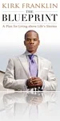

*“Every Christian should gift this book to another Christian”*

*Red+Blue=Purple*

***He offers hope that has been tested.***

*“This world temps us to give up. Sometimes you want to give up. No matter how deep your faith, life can throw some hard pitches at you that you aren’t prepared for. And life gives you no sneak peeks at what’s to come; it offers no “coming attractions” to prepare you for those unexpected pitches.*

*People can be cruel, and things change quickly. Everything you count on today can be gone tomorrow. Often you live feeling either pissed off or pissed on. So we need hope. Not hope in just anything, but hope in something tried, proven, and true. Religions come a dime a dozen. Some people worship lettuce – until they get hungry. Some people worship money, until it loses value. Others worship themselves. And we all know where that leaves us – full of ourselves and full of it. So when you face a mountain of despair, and the pressure of life saps every bit of your strength, you don’t need a god who’s hot with Madonna this month; you don’t need the god whom the rapper thanks win he wins an award for his explicit material. You need the God who isn’t impressed by the material girl, the God who has proven himself worthy. The God with a record.*

*You see, hope left to itself is just an emotion. And that emotion will connect to anything that pretends to be worthy of it. If a figure named Santa Claus presents himself as one worthy of hope, then people – especially children – will put their hope in him. But since Santa isn’t real, hope invested in him is hope wasted. So I don’t just need someone to place my hope in, I need someone worthy of that hope. Someone for whom the evidence has come in, evidence I can sink my teeth into.”*

*- Kirk Franklin “The Blueprint” … A Plan for Living Above Life’s Storms*

My previous post “[**15 Minute Freestyle**](/unknown-black-male-1/2010/10/10/15-minute-freestyle)” for all intensive purposes was a way for me to satisfy my commitment to posting at least once a week. Without any preconceived notions I set out to write whatever came to mind, something easy and fast. In retrospect I understand where each thought was born and truthfully I wasn’t expecting much of a response. I did however receive five one off emails, text, & dm’s from friends who didn’t want to comment on the Blog. Whether directly or indirectly related to any one of my thoughts the common theme was about hope.

The reason I four letter word beginning with L and ending in E The Blueprint is because it’s real. Mr. Kirk Franklin talks from experience and presents his{tory} in away that’s not stuffy, preachy or degreedUP. “♬ ♫ ♪ far from hood but still understand the streets ♬ ♫ ♪”

That excerpt is power{Full} because it reinforces what we already know; We have resorted to using strength according to the wor(l)d rather than according to the word, putting too much hope in man. What it taught | teaches me is that we should counsel from God’s word because it is the truth.

Truth = Honesty. One of my thoughts from the freestyle concerned awareness about self-honesty. I hope everyone received what they needed from me {through Him}, I would like them to know that what I received from them {through Him} was even more valuable.

Deep Bows,

Mr.TramueL
