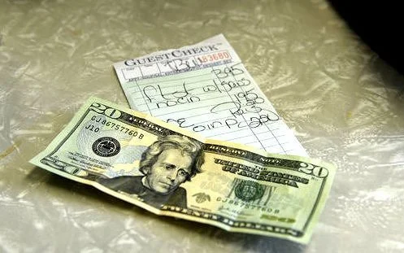

Stop waiting for the balls you are juggling to fall, be proactive ...

*"Sooner or later the bill will have to be paid. Avoidance may only create greater difficulties. Take care of things now. Own up to your responsibilites."*

*- Pay the Bill*
