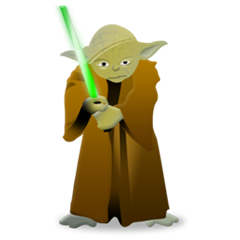

**Attack**

**:** a belligerent or antagonistic action

**Defend**

: to maintain or support in the face of argument or hostile criticism

**:** to take action against attack or challenge

“Why?” “What?” “I think …”

Whether you asked or were asked a question starting with one of these word(s) or statement it will undoubtedly spark a thought & as folk process it, it will lead to them defending their behavior | position.

Law of Human Nature: We hate to be wrong. We will defend ourselves, family & friends even when we know they Debo’d that cookie. The reason(s) why? … man I’ont know. Maybe a need for self-approval? I’ve learned that a compulsive need for self-approval can make a person defensive, self-centered, and stubborn. Maybe to save someone from pain? I’ve learned to be responsible for my own negativity. Translation … avoid absorbing others opposition, stay connected to a sense value in yourself.

I guess we have to understand that when we ask “why”, we are going to get “reasons.” Not the truth, not a lie either but because we feel attacked and because we read on page 506 of the Nothing Is Easier Than Fooling Ourselves Handbook where it clearly states *avoid saying “I’ont know” or “I can’t really explain”  …* we answer quickly, building a foundation to construct that reason && we won’t stop, can’t stop. #BadBoyBaby #TakeThatTakeThat

Mr.TramueL’s Corollary: When we we yield our mighty axe & axe ask someone “why”, we are going to get reason(s) not an effective answer. I have none & therefore offer no solutions, I'm just an observationalist. Hopefully, you the reader can offer some advice.

:: Side Note :: Some of you are vain & will probably think this post is about you, won’t you? You’re right … Communications with September, B’Q, Dwayne & a random lady in line at Costco sparked a thought, a thought sparked a thought process, a process sparked a theory … It’s amazing how we can be separated by age, distance, education, socio & economic backgrounds but have the same thoughts & warring ideals.

Unite,

Mr. “*A theory is always better than its explanation*” TramueL

Posted with WordPress for BlackBerry
