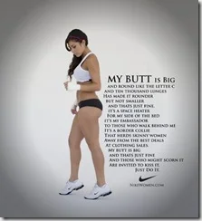

Conversation(s) at work range from politics, religion, relationship(s), music & of course sex. Men brag about their storied histories, while women keep their freaky a little sneaky. My “love” would be proud of itself it were a thing that breathed air & drank water. I deferred from the macho bravado, sexual connotations & innuendos leaving those to the imagination “mental pictures, no cameras please.” Simply smiling as others told stories of their sexcapades.

I personally believe in quality over quantity and as these discussion(s) play out, on average most were above average concerning the number of partners they’ve had. I’ll take them at their word but my experience has been a little different.

***\*\*\*Disclaimer\*\*\****

*The following account, for all intensive purposes is for your entertainment pleasure only. Any likeness to you or your representative is purely coincidental. I have omitted a few hundred of the random women I’ve smashed beautiful ladies from my past as I only want to high-light significant milestones on my Love Time-Line.*

**Mr.TramueL’s “Love Time-Line” set to MusiQ Titles & Lyrics**

**“You & Me”**

*I never thought on the first night
You would bare what you hold so dear to life
And share with me all your innermost fantasies baby
And afterwards in my arms you cried
Had me feeling some kind of way on the inside
Then I knew it was going to be me and you*

My first experience was just that, thought we would be together forever. That innermost fantasy involved a chandelier, measuring tape, my naked member & paper napkin.

**"Just Friends"**

*Girl I know this might seem strange
But let me know if I'm out of order
For stepping to you this way
See I've been watching you for a while
And I just gotta let you know
That I'm really feeling your style
Cause I have to know your name
And leave you with my number
And I hope that you would call me someday
If you want you can give me yours too
And if you don't I ain't mad at'cha
We can still be cool cause*

My second “love” was with the most beautiful girl in the world, but I only wanted to give her the bizness. She thought we were more. I mean who wouldn’t after a year of laying horizontal doing the humpty, humpt. I coined the phrase “friends with benefits.”

**“BabyMother”**

*Listen you know people are you know they gonna talk shit
So be prepared cause we doing this regardless
Of what my mother say or what your father say
We just gotta make sure we on the same page
Cause this is ours it involves nobody else
don't get me wrong we always use a little help
But honestly all we got is each other
And the fact is im the father and you're the mother
Of this kid*

Next up was the longest five years of my life & when we were at the end ... famous last words “Can we do it one last time?” Next thing I know I woke up cutting the umbilical cord.

**"Seventeen"**

*I tried to cut her off
But she wasn't having it
She kept telling me her age didn't mean sh--
And that's when she started to cry
Baby I need you in my life
And without you I just couldn't handle it
So what's a brother to do
(Ohh)
Either way I lose
(So)
I could just say my piece
Or piss off her peeps
And talk it out with the boys in blue
Cause when it comes down to it
(Ohh)
She was just seventeen years old
And I was dead wrong from the door
(Ohh)*

So yeah I met  “Seventeen” somewhere in between “just friends” & “babymother” but refused her advances because she was too young, I inserted into her here because I hit it, shoot she was eighteen now, five foot seven with light-brown eyes, body built like a woman over twenty-five … Judge me, she also becomes the future Mrs.Tramuel (Notice she doesn’t get the trademarked capital L) Famous Quotes “Mr.TramueL! you fuck\*ing with jail bait!” – Seventeen’s Stepdad

**"Makeyouhappy"**
*Oh,
Hey, girl. Help me know,
What is it that really does it for you?
Is it about the things that money buys
Or a man that loves you?
Cause I'm just looking at how good you look
And right away I wanna.
So how do you want it?*

Post divorce. I was free from responsibility & wanted to “love” every woman in the world. I joked about a five (Wo)man rotation. {Insert five names onto the “makeyouhappy” time stamp}

**"Betterman"**

*I got a real good woman now
Someone between a lover and a friend
It feels good when she's around
Cause she's so far from all the others that I've been with*

*Cause I thought I knew what love was but it wasn't until she came and changed my life
And now I realize that*

*All the love in this world, I wanna give to this girl because she makes me wanna be a better man
And all the games I've played are in the pass
Because I know this one's gonna last
It's crazy how she makes me wanna be a better man for her*

I’ll end here because I am a better man, a better man because of what the experiences of my Love Time-Line have taught me. Sexual pursuits uncover the good & bad intertwined in our heart, revealing selfishness or the honorable desires to be loving.

Choose VS Decide … be better

Harm None,

Mr.TramueL may not be right for everyone, please consult your doctor to see if he is right for you.
