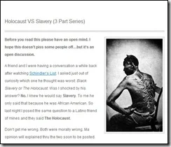
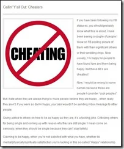
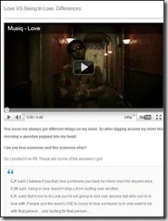

This week I feature the first strong supporter of my Blog Ms. SunnyDelyte! She is fun-loving, adventuresome & imaginative; qualities that are transferable & present in  everything that she is & everything that she does. Mother, Daughter, Sister, Aunt, Friend & Writer.

Sunny is a Taurus, Taurus III to be exact so I thought it would be TramueListic of me to highlight my favorite post based on characteristics of her sign.

Taurus III’s are able to give form to their thoughts, to embody in a  service or artistic activity …

[Holocaust VS Slavery (3 Part Series)](http://sunnydelyte21.wordpress.com/2009/12/23/holocaust-vs-slavery-3-part-series/)

It’s hard for Taurus III’s to keep a low profile. Craving action & excitement, often unable to keep their strong opinions on those around them to themselves …

[Callin’ Ya’ll Out: Cheaters](http://sunnydelyte21.wordpress.com/2010/11/05/callin-yall-out-cheaters/)

Taurus III’s are highly sensitive individuals who need to be left free to express themselves as directly & naturally as they wish …

[Love VS Being In Love: Differences](http://sunnydelyte21.wordpress.com/2010/05/03/love-vs-being-in-love-differences/)

There are soo many more great post, so take some time to browse the archives && check her out! She is on Day 20 of the 30 day blog challenge you can find the links to her most recent post up there, top right … “In the Spotlight”

[FaceBook Fan Page](http://www.facebook.com/home.php?#!/pages/Spoken-Words-Thoughts/400927649611)

[@SunnyDelyte21 on Twitter](http://twitter.com/#!/sunnydelyte21)

[Spoken Words & Thoughts on WordPress](http://sunnydelyte21.wordpress.com/)

Magic Always,

Mr. *“Never give up your natural & instinctive approach to life”* TramueL
