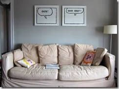

Tis the season! … for break ups. Psychoanalyst would have you believe that holidays are symbolic of change or mark the passage of time. Do folk really want to spend another year with someone when their relationship is sub par at best? Don’t answer, it was rhetorical. Mr.Psychoanalyst has a point but Mr.TramueL believes that folk on Earth have read Seven Radical Ways to Save Money. Page fifteen clearly states “2 is not equal to 3, not even for large values of 2”  Science. Mr.TramueL what does that mean? It means folk don’t appreciate the extra commitments that accompany the holidays. It's a greater investment of time, energy, MONEY and love. Science is true, don’t be misled by facts.… to make ups. Is this relationship worth saving? Will a make up last? Are you ready for a make up? I’ll answer the questions with a question. Did you have a good relationship with your ex before the holidays? Probably not.

Don’t worry Mr.TramueL is a four letter word beginning with L and ending in E enabler. Follow this easy step to surviving a holiday breakup.

“Get a boo in your life”

**The Top Five Boo’s of All Time. All Time.**

The {Boo}ty call Boo

They put the boo in booty. You can lead a horticulture, but you can't make them think.  Listen, listen, listen ho’ is merely short for honey, I just got lazy and dropped the ‘ney like when they drop to their kne … oh never mind.

The Winter Boo

Historically, more babies are born in the Winter months so you should lay without laying. Check.This one is contradictory, think of this in terms of the actual seasons.  In the summer the sun is high at noon. Hot. The move to Autumn tends to cool things down. Warm. When Winter comes, rather than be left out in the Cold, opt for something warm to lay next too. Sometimes we all just want to be held. That is until Spring when things start to heat up again.

The Work Boo

Most of you know this one as the work spouse, but that sounds more fatal attraction if anything. We spend a great deal of time at work, science proves that we have a tendency to form friendships with folk we encounter often. Propinquity effect. We all need someone to laugh at our jokes, eat lunch with & talk about other co-workers with.

The Standby Boo

The Work Boo relationship is non existent after the hours of five p.m. & that’s when you need a standby boo in your life. These are folk you keep around, they have potential but you keep em’ in the friend zone. Immediate [In To Me See](http://mrtramuel.wordpress.com/2010/05/16/in-to-me-see/) is there without the sex or commitment.

The Instant Message Boo

BBM, Twitter, Email, iChat, Texting … Social Media “pushes a Q45” infinite. A network of supportive friend(s) can be valuable. It is important to have others available to call on when the need arises. This is my personal favorite as it teaches us how to stand alone and be independent, or to work through issues which caused trouble in a past relationship before moving in to a new one. Here girls & boys can be willing conduits into the world of men & women. Class.

I see you like to talk, I hear you baby. Get a boo in yo’ life & please feel free to add your boo types in the comments.

Live Well,

Mr. “It’s Winter & I’m so cold” TramueL

peanuts
