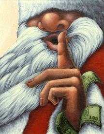

I read this article in the Barber Shop on Saturday, just wanted to share ... Wonderful story.

"Secret Santas spread blessings to folks all over town, from thrift-store shoppers to school employees."

By Eric Frazier  
[efrazier@charlotteobserver.com](mailto:efrazier@charlotteobserver.com)

Posted: Saturday, Dec. 04, 2010

*The last thing Alana McClendon expected to find when she opened her door Friday morning was a bunch of well-meaning strangers handing her money.*

*So when the businessmen and women who go around the city each year playing "Secret Santa" pressed a crisp $100 bill into her palm and wished her a Merry Christmas, she hardly knew how to respond.*

*"It is such a blessing," she said, beaming at them. "Such a blessing."*

*Similar scenes unfolded wherever the Santas went Friday. The participants, who insist on anonymity, take thousands of dollars from their own bank accounts and give bills to strangers around the city.*

*Their inspiration is the late Larry Stewart, a Kansas City, Mo., businessman who handed out $100 bills each holiday season. People in other cities now do it, too, hoping to spread the Christmas spirit and inspire everyone to random acts of kindness.*

*"It's about the pure joy you're able to give people," one Charlotte businessman said.*

*This year, the fourth time they've done this in Charlotte, the Santas were accompanied by about a half-dozen volunteers from the Charlotte police and fire departments. Even Police Chief Rodney Monroe tagged along.*

*Armed with newspaper clippings about needy people, they crisscrossed the city, shepherded by police cruisers and motorcycles. Sometimes, the police officers told them about good-hearted people they could help. They appeared on McClendon's doorstep, for instance, when Monroe asked them to stop by the YWCA's transitional housing complex for homeless families.*

*But they also reveled in chance encounters with needy people. They'd stop driving and hop out of their van when they spotted an elderly woman walking slowly along, or a disabled man walking with a cane.*

*At the Goodwill Outlet store on Freedom Drive, they found Felicia Adams putting out items for customers. She'd gone to work heavy-hearted because doctors in New York said her cancer-stricken father was dying.*

*She needed to get up there fast, but she had no money for travel.*

*When the Secret Santas gave her a $100 bill, she figured she might get to see her father after all. She broke down, sobbing so hard her words came out a hoarse whisper. "I am so happy."*

*As the convoy passed the Brookhill Village apartment complex in south Charlotte, the Santas spotted Dynasty Taylor holding his 2-year-old son Elijah's hand.*

*The Santas made a U-turn and gave Taylor $100.*

*"He's a good-looking boy," one told him. "Buy something nice for him."*

*"This is a blessing, man," Taylor said. "I'm shocked."*

*At Thomasboro Elementary School, the Santas gave bills to hard-working teachers, custodians and secretaries.*

*"I can't work no more today," one custodian said, laughing as she wiped away tears. "They done messed me up."*

*At the Community Thrift Store on Freedom Drive, they found foster parent Donna Green searching the racks for bargains. She'd been laid off in October from her job at a day care center.*

*She, too, broke down crying.*

*"God bless you," she said, hugging one of the Santas.*

*They moved through the store, passing out more bills. A cashier burst into tears. An elderly woman who said she had no heat hugged another who said she was on the verge of losing her house.*

*Green moved past them, heading for the door. She was too emotional to continue shopping.*

*"God is so good," she said. "He sends people in your path to bless you."*

Article From The Charlotte Observer: <http://www.charlotteobserver.com/2010/12/04/1886360/merry-christmas-and-heres-100.html#ixzz17HUbtbEW>
