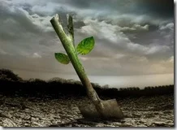

6964995-md

Two Zero One One. Happy New Year!

*Last month was about endings, but this month is all about beginnings.*

The new year provide(s) truth and stimulate(s) us to become active. Resolution(s) are created and we set out to accomplish them.

*Endings*

The end of Two Zero One Zero I focused on all I accomplished.The most significant accomplishment was going back to work full-time after a two year sabbatical, I’m in the field but hey the house n-word’s had to start somewhere.  I’m going covert now to provide you with the lesson(s) and not the actual accomplishment(s); not oversimplifying complex emotions like love or happiness, keeping simple situations simple and not making them complex. #Covert

*Beginnings*

I prepared a wish list for things I want to accomplish in the new year. Goal setting requires reflection, I discovered that I allowed myself so little, that any small, fun change in my lifestyle felt monumental. “For the sake of making a living, I was forgetting to live.” This was more than boundary and time management issues. Fueling my non-stop pace of two jobs and two side hustles were some deep rooted ideas about the how and why of life. Work / vocation is an inescapable reality for most of us, vocation comes from the Latin word to summons or call. I’m listening for the voice that calls me.

Shout out to my Canadian Goddess for sharing an incredible idea.

This will be my last post for a month or so as I shift my focus, I’ll stay in touch with all of you by commenting on your post as well as maintaining my “In the Spotlight” section.

Heading to the moon.

[youtube=http://www.youtube.com/watch?v=Mlwcx2cUkIE&w=375&h=211&hd=1]

Mr. “n*o resolution, just resolve to do and be better*” TramueL
