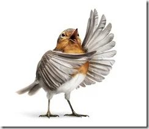

5 4 3 2 1 … I’m In Control

*Control – is the ability to purposefully direct, or suppress, change.*

**Labor Pains** (Rambling from the epidural)

As always my post are sponsored by random observations about nothing, yet everything. As I planned my return to the Blogosphere (still not ready) however part of my resolve for Two Thousand One One is to tackle procrastination & my fear of commitment. I’ve committed to posting once a week and I stated that I would return in February, so here I am. Procrastination (check), Commitment (check). Win. Win.

Any who, I thought about my Blog and the content of said Blog. I’ve observed that I tend to shy away from politics, current events and dating. I’ve found that if someone makes three consecutive guesses with respect to any of these they become an expert. I refuse to have conversations about any of these unless it’s with a Professor of Political Science, Economics, Anthropology or Halle Berry naked. Judge me.

> Conversation, n. - A fair to the display of the minor mental commodities, each exhibitor being too intent upon the arrangement of his own wares to observe those of his neighbor.
>
> Ambrose Bierce – The Devils Dictionary

People tend to be owned by their opinions. Opinion, position, both so matter of fact, so end of discussion, case closed. … I’m open. There is always more to know, more to learn & consider. I’m okay with “I’ve changed my mind”

“Mr.TramueL where are you going with this?” … I’m glad you asked.

**The Baby**

I take in a lot from my environment to the point I may over analyze the smallest of details. While I tend to stay away from the above mentioned it’s hard not to focus on relationships, certainly men & women but all relationships; Four Letter Word Beginning With L & Ending in E, Familial, Friendship, Work & Marriage. The women in my life, and by women I mean girlfriends, and by girlfriends I mean girls that are friends. Plutonic. They all seem to be on the same roller coaster ride with the men in their lives. One essential observation is the attempt at control displayed by both parties. That control (or lack of) gives way to power plays and power struggles.

I don’t have a solution, however those struggles can probably be attributed to some mama and daddy issues. I digress. I like to look at things holistically, if you recognize it as control or power you can use your super human power for good not evil. 1 Use *power* to achieve mutual goals. 2 Tune in to the *power* of a four letter word beginning with L and ending in E. Recognizing that neither of you want to let up your guard, you should know that defensive posturing prevents real In To Me See.

**Afterbirth**

Be open. Be susceptible to change.

Mr. *“No one {Wo}Man should have all that Power”* TramueL
