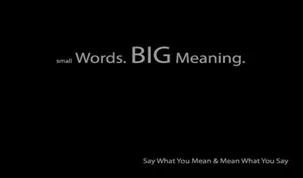

|  |  |  |
| --- | --- | --- |
| Thank You | You Matter | I’m Sorry |
| I Appreciate You | I Care | I Admire You |
| I Love You | You Can Do It | I Need You |
| I’m Here For You | I Support You | Great Job |
| I Forgive You | You Are Safe | You’re Welcome |
| I Admire You | You Can Trust Me | You Are Beautiful |
| I Was Wrong | I Believe In You | ``` I Understand ``` |

Happy Valentine’s Day. Spread Love.

Mr. *“Demonstrative in Love”* TramueL

Get Like Me.
