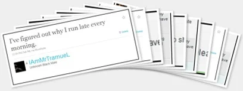

I can get up early every morning but fail to leave the house in enough time to be early for work, always rushing …

[Life Of A Tweet](https://cid-47a0dc0c0989d1cc.skydrive.live.com/redir.aspx?page=browse&resid=47A0DC0C0989D1CC!218&type=5&authkey=wJdjFH!YcKY%24&Bsrc=Photomail&Bpub=SDX.Photos)

[VIEW SLIDE SHOW](https://cid-47a0dc0c0989d1cc.skydrive.live.com/redir.aspx?page=play&resid=47A0DC0C0989D1CC!218&type=5&authkey=wJdjFH!YcKY%24&Bsrc=Photomail&Bpub=SDX.Photos)

[DOWNLOAD ALL](https://cid-47a0dc0c0989d1cc.skydrive.live.com/redir.aspx?page=downloadphotos&resid=47A0DC0C0989D1CC!218&type=5&Bsrc=Photomail&Bpub=SDX.Photos&authkey=wJdjFH!YcKY%24)

… After further analysis I’ve moved away from spending so much time cleaning “it” because “it” hasn’t been near anything in a long time and by a long time I mean a few months and by a few months I mean almost a year. Although my shower is still 30 minutes, I now concentrate on my face. Here is my logic; beauty captures attention, personality captures hearts. Science!

Face + Beauty + Heart(s) = Someone Touching “it”.

Mr. “*Science is true, don’t be misled by facts”* TramueL
