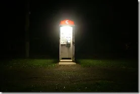

“*Don’t call, come get me …* “

**Short Stories**

Transforming, experiencing others along the way …

*Friendship* is rooted in Lve. The Latin word for love is amor. The word for friend is amicus. The word for friendship is amicitia.

Self-Analysis. I recognize a lot of compulsive desires as a problem for me, these are symptoms however. The root of the problem is negative self-talk and feeling deprived. *Brian* often talks me into believing that I’m somehow deprived and missing out on something important. It’s very easy to throw out this emotional attachment once I make it conscious and play it forward.

Brian & Mr.TramueL need a practical modus vivendi.

Great friends exist for each other, they are demonstrative in their concern and care. We all need spiritual friendships that produce truth, fun, inspiration and most important Action.

My problems as lessons give me the experience to be that friend most times, providing the medicine of life. Recently I’ve been on the receiving end … friend(s) have listened, encouraged, prayed, acted and believed. Deep bows.

I took some credit in that last paragraph with references to me, myself & I but there is no “I” in GOD, I know it’s HIM that allows me to counsel from HIS word. Word.

*“Call me when you need me … I’ll be right here”*

Love & Light,

Mr. Brian *“and ‘nem”* TramueL

[youtube=http://www.youtube.com/watch?v=O9gekEoBDa4&w=261&h=195&hd=1]

@LeonTimbo Live Soul Session Columbus, OH
