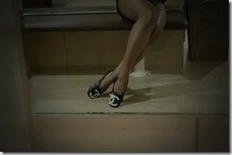

We’ve all been there; an event, a place or someone sharing a few choice words, they cause us to re:play the occurrence over & over in our heads. First thought always starts similar to this "I wish I would have responded ..." That thought never goes away. I believe we store it in our mental Rolodex so that we are able to draw on that experience in the event we find ourselves in the exact same place.This might be too much information for ya'll but it is relevant to my story. It's been a long time since I had a strong beat to step to. It started as a lack of opportunity for a dance partner who appreciated my rhythm, it has now shifted to improving my position and improving my routine before committing to a new partner. The last ten years have provided a strong beat to step to simply by turning over and giving that inviting tap & uttering those famous words "Baby? You sleep?" ... the shake & wake is no longer an option as Mr.TramueL is no longer a plus one. Music evolves over time but there is always one constant, it always provides a strong beat to step to, when the music stops you can only imagine the withdrawal your body has; lucid dreaming, thinking about dancing every two minutes and considering dance partners you would never imagine doing the two-step with. Next your mind takes you back and you start to re:member every possible dance partner you've had, wish you could have shared an experience with and then Boom! You start to visibly remember being asked to dance but didn't realize someone was trying to practice their dance moves, wanting you to elevate their  feet in the air above your shoulders. This is where the phrase dancing on air gains its meaning & ya’ll know Mr.TramueL loves some feet. Judge me. That would have been a performance  neither one of us would have forgotten. I Am Mr.TramueL, get like me.

**re:trospect**

Mr.TramueL and The TramueL Formerly Known As have been separated for a year, coincidentally almost the same length of time I've been without a dance hall queen. I've always connected with women easily, you know the BIG brother type scenario, cool to talk with, opining about life, all of it's ironic twist and how they may sometimes startle us.Side Note: I would hit. Where were we? Oh! ... I have a few girls that are friends. Platonic. So the connection I shared with "she" <--- We will use this in place of her name to protect the innocent and also me in case she ever reads my Blog. “She” and I had that type of relationship, I had been out of the game for almost 14 years so I didn’t know how to approach women or much less decipher if what "she" wanted from me involved more than talking on the phone, visiting each other or hanging out, it was all relative. I assumed she was being friendly and helping me through some things and I afforded her an opportunity as a willing conduit into the world of men.

**the:chase**

She: "Hey? What are you doing around five? I'm on your side of town & I thought I would stop by."

Me: "Not nothing, cool. I'm here."

She: "You have anything to drink?"

Me: "H2O & some Hi-C Fruit Punch"

She: "Boy, you so crazy! I'm talking about a real drink."

Me: "Oh, yeah I have some Vodka"

She: "Oh, okay. I really need a drink."

Me: "See you in a few"

**the:scene**

I'm chilling in the bedroom watching T.V. I know this seems player, however there was only one t.v. & it was in my bedroom she is sitting in a chair across from me. I'm totally oblivious to all of the signs she is displaying It is only in retrospect that I’m able to visibly replay & understand what was going on She takes her shoes off and complains about how much her feet hurt1 obvious that she wanted me to rub her feet she is looking at me like Brian if you don’t turn off that t.v., get off the bed and come get on me. I thought she was buzzed Then “she” begins to talk about dancing and things she’s never experienced, a bucket list of moves and routines no one has ever brought that level of movement to or out of her. Ding, ding, ding! Dude? Seriously? Me being naïve, I go into my spill about being passionate and demonstrative in dance, gave her all of the astrological associations of Virgo’s and dancing.

Blank stare. Blink. Blink.

**the:end**

I walked her to her car and she said good night.

“She” I didn’t know! Listen, listen, listen! If you’re ever on my side of town again …

*Mr. “Sex is Fire, Celibacy is Water. Both can Purify” TramueL*

amerie-shoe-7-1024x680
