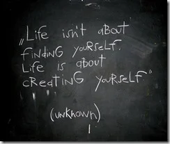

Someone special shared these words with me a few months back, I believe they were stuffed inside of her fortune cookie on the packaging of her green tea bags. {She reminded me}

How simple, perfect & profound.

I searched for the origin, didn’t find the source but determined that the phrase is a formula for devotion, not exclusive to the pursuit of God & religion. Devotion is viewed as the combination of love and dedication that motivates folk to excel.

The words by themselves have such a broad meaning but together they do create a  formula. *In my Savon from Love Jones voice…* “Let me break it down so that it is forever & consistently broke.”

**Obey.**

To submit or conform in action to some guiding principle(1), impulse(2), or one's conscience(3.)

As it relates to the other words: “to hear,” “to listen.” The highest significance of its usage, however, is that of the relation of man & (wo)man to God. The first duty of love is to listen…

**Love.**

“*And think not you can direct the course of love, for love, if it finds you worthy, directs your course.”*

*—*my man, your man, Khalil Gibran I’m gay for this dude & all of his writing(s).

As it relates to the other words: Love is caring in action. Love isn't what we *feel*, but what we *do*.

**Serve.**

To give homage and obedience to.

“*You can not live a perfect day without doing something for someone who will never be able to repay you.”*  —John Wooden

As it relates to the other words: Service humbles us. Obedience, humility & love all begin with service.

**Excel.**

To surpass others or be superior in some respect or area; do extremely well.

As it relates to the other words: To do or be better; to have your obedience, love & service show in everything that you do.

*You have to follow your marching orders, even when the storms come. Obey. Give of your whole self, let you heart go through the pain. When it’s done it will reveal that God’s light always shines through. Love. Hold your commitment no matter what circumstances you cross. Serve. Let “the light” shine through into all that you do. Excel.*

Mr.TramueL
