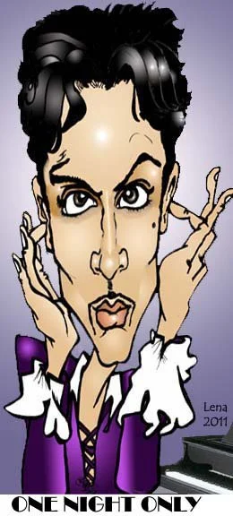

**“The Stuff Of Legends"**

**By Lena J. Hopkins-Jackson**

Before you attend a concert of ANY rock-star around long enough to live up to the term ‘legend’; you MUST realize a few things:1# They are NOT going to do every song in their music catalog, *so-get-over-it* and enjoy! 2#. Their fans probably resemble every, breathing thing walking the earth; as ubiquitous as water and as unique as finger-prints so the crowd itself is part of the experience!3#...and finally, whether it’s your 1st time or 100th time seeing said performer, ‘Nothing-Compares-To-A-LIVE-show”…especially with an artist who KNOWS how to give the fans their money’s worth ! With that said, I had an abso-freaking-lutely, great time at the Prince concert on Thursday March 24, 2011 in Charlotte, NC….and I recommend ALL fans , especially those who have never seen “His-Royal-Badness” in concert to see him now while he’s still in the prime of his twilight years as a performer.

***Here’s why….***

Well, the actual festivities began for me @ 5:45 (ahead of the 7:30 *‘shed-yule’*) while still waiting in line to get into the “Time Warner Cable” arena. My dear, friend Chauncey who graciously bought both of our tickets the day they came out wanted to get there early AND she was convinced other Prince-fans would be practically sleeping outside the joint and lined-up for miles. I assured her that this was Charlotte, *not* Manhattan or LA, and our city is a walk-up market so folks would be buying tickets the day of and mosey-ing-on in leisurely-like.( *one lady scrambled into her seat 15 minutes AFTER Prince opened…nachos & beer in tow because that’s what  REALLY matters after buying $100 and-up tickets, riiiiight*?) So after chatting-it up with everyone in our line within a three foot radius and snapping endless photos like European tourists; we hurried to our seats to wait for Charlotte’s own Anthony Hamilton to open the show!

The man did NOT disappoint either: clad in a dark blazer, crisp, white shirt with tie and blue-jeans (*as well as his band*) Anthony and his background singers resembled a sepia-version of Billy Joel mixed with some ‘Southern-Funk & Soul’. He performed with REAL musicians and his own *trademark, church-choir, REAL singing pipes* ( an anomaly now-a-days it seems) The crowd showed mad-love, especially his fans but to be  honest I knew that as much as some of us enjoyed Mr. Hamilton’s set, there were still others who clapped the loudest *AFTER* he left the stage. Don’t-get-it-twisted: he was great but the die-hards were there to see “The legend”, who cares who opens?

Still, Anthony did his city proud; kudos and props to him!

After a  mercifully quick, break & switch-up in sets the moment we were all waiting for…”His-Royal-Badness” took to the stage! We heard Prince before we saw him as he greeted us with a “Hello-ooo Charlotte!” and the unmistakable guitar rift from “**When Doves Cry”**! The audience responded with near-deafening applause and screams of ‘*Iiiii-Ooooo-WAaahhh*”  and other indistinguishable, yelps of pleasure! Dressed in signature purple and black *(the 1st of about four, dazzling costume changes including a bling-tastic gold suit)* Prince turned every one in the crowd over 30 into seventeen year olds again before even reaching center stage. Blazing through his 1st set of 70s-80s medleys, “HRB” gently told his admirers this disclaimer: “If I perform every song I created that was a hit, we’ll be here all night!” Loosely translated: “Don’t-be-mad-if-I-don’t-play-YOUR-favorite-tonight,-there’s-always-the-CD-or-“Pandora Radio Station”-for that!” From snippets of **“Alphabet Street”** to **“Darlin-Nikki”** the fans new and old were certain within the 1st five minutes of a two–hour show-stoppa’ that tonight would be legendary! Indeed it was, Prince and his band took the theme of what the opening act started with and amplified it times a thousand: REAL MUSIC IN A LIVE SHOW!!! At 52 years old, “The Artist” still plays guitar, piano, sings and dances like a man half his age! From our excellent lower-level seats ( *Thank-you Chauncey*!)we could see not only every, funky, “*James-Brown-School-Of-Dance*” move he did  BUT  the random, bemused facial expressions he had on his beautiful, well preserved face *( good genes, y’all! I saw NO traces of “House-Of-Wax” Botox injection on that gorgeous visage!)*

This is a man who LOVES his job and his fans; he was clearly having fun too and basking in it all! One of the show’s highlights came early on when he performed what was hands-down one of the night’s most memorable moments: a quick tribute to the “King-Of-Pop”, Michael Jackson! Mixing in parts of “**Shake-Your-Body-Down-To-The-Ground”** with **“COOL” (** *co-written & produced by Prince  under alias “Jamie Strarr” and performed by his ‘royal-band-in-waiting’, “The Time*”) Prince told the crowd “ *This is my joint!*”…and “*I am kind of scared to sing this song*!” so he let US and his background singers sing Micheal’s lyrics to HIM. For all those old-head fans who remember the ‘Prince-versus-Micheal Jackson’ beef that started in the 80’s, do note that it has been ground-up and finished as one legend paid homage to another who is sadly no longer with us.

Naturally, the audience lost it, and the generosity and greatness kept-on-a- coming!

Prince not only shouted-out local R&B station 92.7 twice but he shouted-out the WHOLE city of Charlotte for its southern-hospitality. He even sang a quick little ditty to us with simply “North Carolina” as the lyrics; proving that some artists can sing ANYTHING and people will love it! He then recognized Anthony Hamilton as continuing the legacy of REAL music and let the lime-light shine on various members of the “NPG” ( *New Power Generation for newbies*). ..and this MUST be mentioned: Prince had not only an almost all-female presence accompanying him on stage BUT I admire him even more for using mature, full-figured, back-up singers who brought an energy and feline-funkiness of their own! As a member of the “chunky-but-funky” tribe myself, I couldn’t help but ADORE what resembled a “Layne Bryant” runway show at times! As a sign-o-the *changing* times, Prince’s new band is a complete departure of the old “NPG” or “The Revolution” where ***most*** of the ladies-in-waiting on stage were below a size 8, café-au-lait or lighter, long hair and not older than 25. These women were big, bad (*bald even*!) and FIERCE in an un-Hollywood kinda’ way and I LOVED it!

Finally after inviting two, lucky fans on stage during a cover of ‘**Play That Funk Music White Boy**” ( *one of which had an outfit  labeled humorously by Prince as “Sesame Street”*) then doing extended performances of various number 1#s  such as “**Controversy”, “ Nothing Compares To You**” *( the beautiful, bald-headed back-up singer replaced Rosie Gaines and rocked it*!) **“Cream”, You Need Another Lover”, “The Beautiful Ones**” and ending the set with **“Purple Rain”**, which as expected….brought the house down as well as purple confetti and ‘contraband’ camera-phones twinkling into the air for a perfect, near-climactic finale`.

Now the funny but sad thing towards the end was watching a few newbies leave the stadium thinking the show was over…SUCKAS! Any, self-respecting fan of a living legend musician KNOWS this: -Just because the performer says “Goodnight” doesn’t really mean its’ the end-! Presumably Prince was freshening up and relaxing below the stage while the audience gave HIM back what he deserved at this point in his over 30 year career : Screams and thunderous applause for an encore and in some cases….abject adoration!

After a twenty minute wait, he ascended back onto the stage from the hidden platform and rocked two final songs, ending with **“Baby, I’m A Star**” before telling us ‘*Goodnight*’ for real this time and like another legend, left the building.

Twenty minutes later people were still waiting in hopes that he was jiving us and would come back out to do any of the ones we didn’t hear that night..NOT!

My friend and I finally stumbled with our sore-feet and even more sore voices out of the arena; blissfully floating amongst a sea of purple wearing fans who were also utterly satisfied and exhausted from standing, dancing, House-Quake-hopping all night as well*.( albeit willing to stay for another hour with Prince if permitted, I’d bet!.)* It was a magical night and like the man himself……legendary.

My final words: see-the-show-if-you-can….as anybody who was there that night would tell you “Nothing Compares To Him”.

LHJ…..~NPG-fan-4-life~

**... Sooooo I had to express what a great night it was; check this review out as my alias "Urban Carrie Bradshaw" and other cartoons like "Bohemian Cafe" that I'm doing on "Urban Tymes" magazine's website @ <http://www.urbantymes.com/>**

