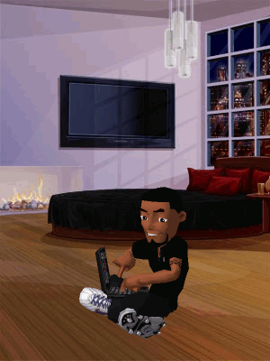
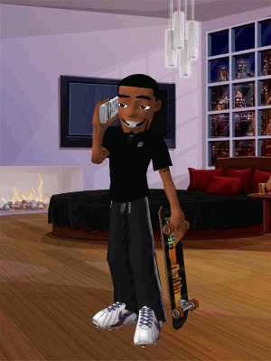

**Conversations via Technology VS Conversations via Phone**

♬ People don’t talk no more ♫ all they do is this ♪ all they do is this …

Textersations, e-mails, blog posts and social media sites are the new Moto M900’s.

I know smart people and they will argue that a phone could be considered technology. Sit ya’ll smart asses down. Ya’ll make me cuss. Please ASSume that I’m referring to traditional vs written.

Conversations are interactive, extemporaneous exchanges of thoughts and feelings between folk(s). Mr.TramueL is neither a proponent or opponent for either; the pros can be cons, cons can be pros. Science is true, don’t be misled by facts.

**Technology**

Multiplicity of conversation(s): Emailing your co-worker, on g-chat with your boo, texting your ex, messenger with your sweetie, Tweet’s about the cold sore on your lip, photo’s on Facebook of your freshly painted toe(s). Ya’ll already know how I feel about feet. Ladies, inbox me!

Spontaneous: With respect to Twitter, Facebook, BBM & now LiveProfile, depending on the number of friends or followers your conversational partners are endless. Smashing random folk through tech is a lot safer than smashing random folk in real life. Tech responsibly my friends.

Rules: Don’t apply. They are contextual, they apply in certain situations and not in others. I’m … my age isn’t important, but I won’t curse in front of my mom but I can text the F word while she is sitting right next to me.

**Phone**

Protect Privacy: Mr.TramueL has recently become green, while trying to save some green I’ve become a frequent rider of CATS, no not that! Ya’ll are so nasty! Charlotte Area Transit Authority & nothing is more important than the ability to move a conversation to a private area. I mean not everyone needs to know the result of your stool sample.

Structure: A beginning, middle and an end. Have you ever had a conversation on a Social Media site were you respond and eagerly await a reply to your rather witty response? How did that make you feel? Sad, I know. No words hurt, abrupt departures can hurt. While using the phone, unless you are using an iPhone on A T & T-Mobile & your call is dropped, there is usually a formal close to spare your fragile ego.

Engagement: You can not detect mood, tone or inflection through technology.Voicetime allows you to demonstrate understanding. It also allows you to maintain coherence. You know what I’m talking about, we all have that friend that rambles on with messages all over the place while texting, communication should be relevant to the previous message. If you don’t know what I’m talking about, that friend is you.

What ya’ll got? Any pros or cons to Teching VS Calling?

Mr. *“These are my fingers, this is my phone … I use these for pleasure, I use this for fun”* TramueL

Oh! Introducing my new closing, shout out to September ‘cause I stole it from her …

I love Blogging you!
