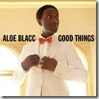

I was first introduced to Mr. Blacc’s music through what I believed to be a McDonald’s dollar menu commercial. You may have seen it on Centric, it truly sounds like a McDonalds commercial in support of their dollar menu. “***[I Need A Dollar](http://dl.dropbox.com/u/2869333/01%20-%20I%20Need%20A%20Dollar.mp3)***” is the lead song from **[Good Things](http://aloeblacc.com/)**, as the tune played I heard a familiar, soulful voice that immediately grabbed my attention. What I found was that it was not an infomercial but a “Spotlight” as Centric Selects / Featured Artist. In any event, it put to mind the Coca-Cola Commercial featuring Tyrese, where he has on headphones and really feels the music or him-self and begins singing aloud. I tried that once but when I opened my eyes instead of thunderous applause I got a bunch of gas faces.

The music is very soulful, reminiscent of greats from the past. Mr. Blacc, born Egbert Nathaniel Dawkins III is hailed by many as "the voice of the recession" … I’m neither a music critic or reviewer but a fan so I will leave that for the Music Bloggers & Editorials. There is however an undeniable conscious; a political soul that truly reflects our current state.

He Said, She Said …

***“ … my master plan is to use music to expose what needs exposing”** - Egbert Nathaniel Dawkins III*

*4 out of 4 Headphones*

Mr. *“If my name was Egbert I would find a clever moniker too”*  TramueL

