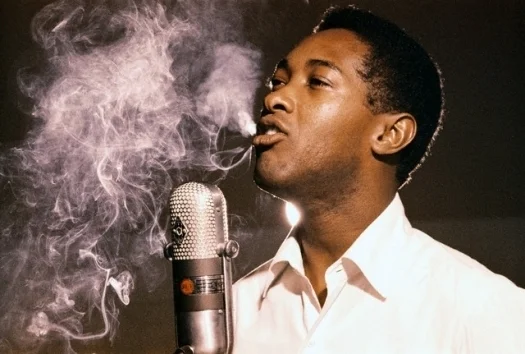

A\_Change\_Is\_Gonna\_Come.mp3
[Listen on Posterous](http://eyetramuel.posterous.com/a-change-is-gonna-come)

*I was born by the river in a little tent*  
 *Oh and just like the river I've been running ever since*  
 *It's been a long, a long time coming*  
 *But I know a change gonna come, oh yes it will*

*It's been too hard living but I'm afraid to die*  
 *'Cause I don't know what's up there beyond the sky*  
 *It's been a long, a long time coming*  
 *But I know a change gonna come, oh yes it will*

*I go to the movie and I go downtown*  
 *Somebody keep telling me, "Don't hang around"*  
 *It's been a long, a long time coming*  
 *But I know a change gonna come, oh yes it will*

*Then I go to my brother*  
 *And I say, "Brother, help me please"*  
 *But he winds up knockin' me*  
 *Back down on my knees*

*Oh there been times that I thought I couldn't last for long*  
 *But now I think I'm able to carry on*  
 *It's been a long, a long time coming*  
 *But I know a change gonna come, oh yes it will*
