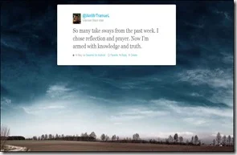

The Week of Depth

A reprise to *“**[Four Letter Words Beginning With L](https://www.tramuel.com/iam/2010/08/16/four-letter-words-beginning-with-l/)”*

**Of Loss**

A wife lost her husband, children lost their father & a grandfather, a church lost a member, co-workers lost a friend and a community lost a steward. Mastering fear & anxiety, I’ve learned how to respond to death by being open, honest and sincere. Don’t suppress affection, tell others how you feel constantly and show them often.

Rest in peace Frank, you will be missed.

**Of Life**

Filtering out negative and pessimistic emotions lead you to positive thinking; more options and possibilities exist.

**Of Lust**

I went *[dancing,](https://www.tramuel.com/iam/2011/03/11/in-retrospect/)* we had a great time but we will not become permanent partners. I think it was something we both needed.

*“Sex is fire, Celibacy is water … both can purify”*

My truth? Afterwards the void was still there, there is nothing like dancing with someone you absolutely adore, cherish and four letter word beginning with L and ending in E.

**Of Love**

I’m open.

Mr. “*Be Responsible But Don’t Forget To Dream*” TramueL
